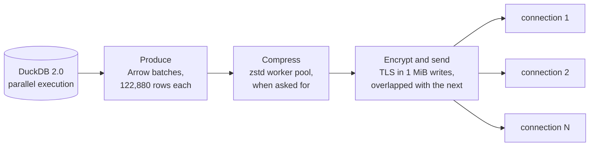

import { Aside, Card, CardGrid } from '@astrojs/starlight/components';

Hardcharger is fast for two reasons. DuckDB 2.0 runs the query, and on TPC-H it beats DuckDB
1.5 in-process before any network is involved. Then the result travels through an
**asynchronous pipeline** in which no stage waits for another unless a queue is full.

## The result pipeline

<CardGrid>
  <Card title="🔁 Overlapped stages" >
    DuckDB keeps producing into a buffer bounded by bytes (32 MiB) while earlier batches are
    encoded, compressed and encrypted. The socket never waits for the next batch to be built.
    With TLS on, one stream runs as fast as plain HTTP.
  </Card>
  <Card title="🧵 Parallel compression">
    When a client asks for zstd, a pool of threads compresses several batches at once, and the
    batches still leave in order.
  </Card>
  <Card title="🔐 TLS without a tax">
    The TLS stream encrypts a whole gathered write (up to 1 MiB) at once and sends it while it
    encrypts the next one, instead of one 16 KB record per socket write.
  </Card>
  <Card title="🔀 Partitioned results">
    A client can read a large result as several partitions over separate connections at once,
    past the limits of one TCP flow and one client core. Order is kept when the query asks for
    one.
  </Card>
  <Card title="📦 Big batches">
    Results go out in batches of up to 122,880 rows (one DuckDB row group), so per-batch overhead
    is negligible. A small query is still one batch and one round trip.
  </Card>
  <Card title="📥 Parallel ingest">
    Uploads are read from the socket in 1 MiB pieces and inserted on all of DuckDB's threads, in
    one transaction that keeps the upload's row order. A failed load leaves nothing behind.
  </Card>
</CardGrid>

## Correctness is not traded for speed

- A result is complete only when every partition has arrived **with its end-of-stream marker**.
  A query that fails mid-stream ends its streams without the marker, so it can never look like a
  short, successful one.
- An interleaved split puts batch `j` of the result in partition `j mod k`, so a client rebuilds
  the exact order; the benchmarks found ordered and unordered reads equally fast on a LAN.
- Bulk ingest is one transaction: all rows or none.
- Every benchmark run checks its results: row counts and column sums against the server's own.

## What to tune

| You want | Do this |
|---|---|
| A large result faster over a fast network | Ask for partitions: `adbc.warp.statement.result_partitions` (ADBC), `resultPartitions` (JDBC), `--result-partitions` (CLI). 8 is a good start; the server caps it at [`max_result_partitions`](/reference/configuration/#max_result_partitions) (32). |
| A large result faster over a slow or long link | zstd (`adbc.warp.ipc_compression=zstd`, JDBC `ipcCompression=zstd`) cuts the bytes to about a quarter. On a LAN it is slower than none, because the client decompresses on one core. Over high latency, prefer up to 8 partitions, in any order. |
| Long queries behind a proxy | Submit asynchronously (`adbc.warp.statement.async`, JDBC `async=true`) so no request outlives the proxy's timeout. |
| Bounded memory | [`memory_limit`](/reference/configuration/#memory_limit), and [`max_concurrent_statements`](/guides/statement-control/#the-statement-queue) to queue rather than overload. |
| Smaller first batches | [`result_batch_rows`](/reference/configuration/#result_batch_rows): a full scan's first batch takes about 21 ms at 122,880 rows and 2 ms at 2,048, but throughput drops with small batches. |

A tested example of reading partitions is in [Warp SQL in one page](/concepts/warp-sql/#partitioned-results).

## What Hardcharger doesn't do yet

<Aside type="note">
These are measured, not guessed: see [Benchmarks](/benchmarks/#where-hardcharger-still-loses).
</Aside>

- **Uploads use one connection.** Bulk ingest is one HTTP upload, so it can't go past one
  network flow (about 1.1 GB/s of Arrow on AWS). Partitioned uploads would need a protocol
  addition, as results got.
- **One stream over a long link** is limited by TCP buffers (about 85 MB/s at 46 ms with Linux's
  default 4 MiB send buffer). Ask for partitions there.
- **zstd on fast links** costs time in the client, which compresses or decompresses on one core.
