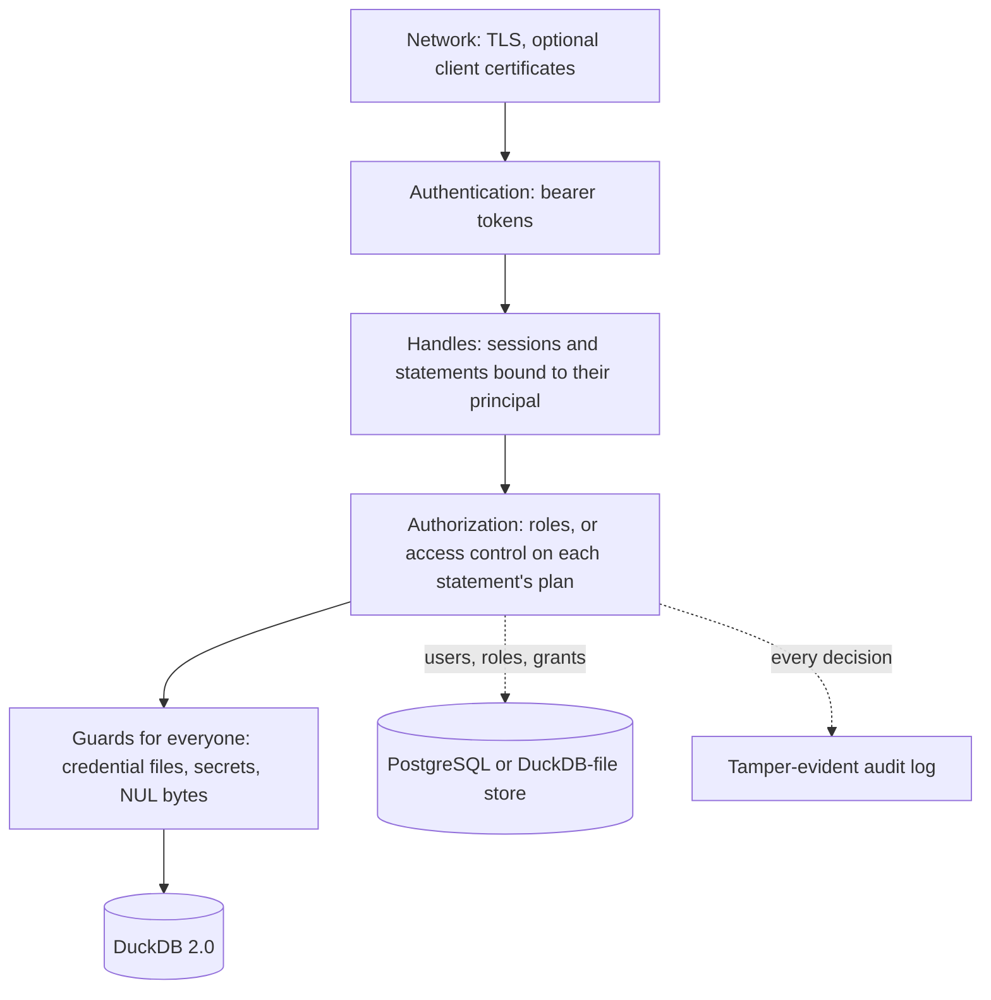

import { Aside } from '@astrojs/starlight/components';

Security in Hardcharger is in the core, not bolted on: every request is authenticated, every
statement is authorized inside DuckDB against its own plan, and some guards apply to everyone,
administrators included. This page is the map; the guides have the steps.

## Layers



## Transport

Turn on TLS with a certificate and key ([guide](/guides/tls/)); add `--mtls-ca-cert` to require
client certificates as well. Plain HTTP is for loopback and development: the Warp SQL spec says
servers should refuse it elsewhere, and you should put Hardcharger behind TLS before anyone else
connects.

## Authentication

Every request but discovery and health carries `Authorization: Bearer <token>`. Credentials
never travel in URLs, and the server never reads cookies, so cross-site request forgery has
nothing to work with.

| Who | How they sign in | What they get |
|---|---|---|
| The administrator | `--admin-username` (default `hardcharger`) and `HARDCHARGER_ADMIN_PASSWORD` | The `admin` role: a superuser |
| Store users (with access control on) | Their own password, set with `CREATE USER … PASSWORD` | Exactly what their grants allow |
| Identity-provider users | An OIDC ID token, exchanged for a server token, or the browser sign-in flow (Warp SQL's `oauth_browser`, on the server's own port) | A role from the token, or a store user's grants ([SSO guide](/guides/sso/)) |
| Scoped tokens | A token minted in SQL with `CREATE SCOPED TOKEN` | A subset of a user's rights, for a limited time |

Server tokens are JWTs signed with [`secret_key`](/reference/configuration/#secret_key) and
last [`token_lifetime_seconds`](/reference/configuration/#token_lifetime_seconds) (a day). Give every
replica of a cluster the same key and set `allow_cross_instance_tokens` to accept each other's
tokens. A store user's token is checked against the store on every request: dropping or
disabling the user, changing their password or revoking a scoped token ends their sessions at
once, on every replica.

## Handles belong to their owner

A session is fixed to the principal that created it, and every statement, prepared statement
and retained result belongs to its session. The server checks the token's principal against the
session in the URL on every request. Someone else's session id gets the same `404` as one that
never existed, so ids can't be probed, and holding an id grants nothing.

## Authorization

Hardcharger has two models. Pick one per server.

**Without an access-control store**, each token carries a role:

- `admin`: everything.
- `user`: SQL on the data, but no file-system or instance-level commands. The **admin command
  guard** refuses `ATTACH`, `INSTALL`/`LOAD`, `COPY` to or from local files, reading local files,
  secrets, `SET GLOBAL` and similar, so users who share a server can't read, write or reconfigure
  the host.
- `readonly`: like `user`, and nothing that modifies state.

Sign-in tokens may also carry [catalog access rules](/guides/catalog-access-rules/): read,
write or no access per catalog.

**With access control** ([`rbac_store_uri`](/guides/access-control/)), users, roles and grants
live in a PostgreSQL database that every replica shares (or, for development or a server that
will only ever run one replica, a DuckDB file), and you manage them in SQL. Each
statement is checked inside DuckDB against its own plan, after binding and again before
optimizing, so nested SQL, views and macros can't route around a grant. Anything the check can't
classify is refused. Views read with their owner's rights; [row and masking policies](/guides/row-policies-and-masking/)
filter and mask what a role sees; tenants keep groups of users apart; an Open Policy Agent
service can veto any session or statement. Reaching outside the database (files, object storage,
URLs, `ATTACH`, extensions, secrets) needs a system privilege such as `READ OBJECT STORAGE`, and the
storage privileges can be limited to locations (`ON LOCATION 's3://bucket/prefix/'`). No user
touches an attached DuckLake catalog's storage directly, and only the administrator sees where an
attached database lives (`duckdb_databases().path`, which can hold a connection string's password).

## Guards that apply to everyone

Some things are refused whatever the role, administrators included:

```console test exit=1
$ HARDCHARGER_PASSWORD='change-me' hardcharger --host localhost --tls=false --username hardcharger \
    --command "SELECT * FROM read_text('/etc/passwd')"
Error: Permission Error: Permission denied: Hardcharger blocked access to '/etc/passwd' (system account files). Hardcharger keeps credential and system files on the server host out of reach of SQL, whatever the role.

LINE 1: SELECT * FROM read_text('/etc/passwd')
                      ^^^^^^^^^^^^^^^^^^^^^^^^
```

- **Sensitive paths** ([`block_sensitive_paths`](/reference/configuration/#block_sensitive_paths), on
  by default): `/etc/shadow` and friends, `/proc`, mounted secrets, `~/.ssh`, `~/.aws`, `~/.kube`,
  DuckDB's stored secrets, the server's own TLS key, init SQL and config file, and anything in
  [`sensitive_paths`](/reference/configuration/#sensitive_paths). The check sits in
  DuckDB's file system, so it sees the path DuckDB is about to open, list, write, move or remove,
  however the statement arrived at it: a concatenation, a variable, a prepared statement's
  parameter, `query('…')`, a macro or view, `file_search_path`, `~`, `..`, a symlink, a second hard
  link, a different case. A glob reaching into a protected directory from above (`/home/*/.ssh/*`)
  lists its other matches only; one whose fixed part is protected (`~/.ssh/*`) is refused. SQL text
  is not scanned for paths, so literals such as `'{"a": 1}'` or `'.*'` work as anywhere else.
  `ATTACH … (TYPE sqlite)` and the `sqlite_scan` / `sqlite_query` / `sqlite_attach` functions,
  which open files with SQLite's own library, are refused at plan time for these paths too.
  Two limits: the server's startup, the operator's init SQL included, runs before the guard
  switches on (so init SQL may read a mounted credential to create a secret), and
  `postgres_scanner`'s PostgreSQL client library reads `~/.pgpass` and files named by `passfile=`
  or `sslkey=` itself, so a role that may `ATTACH` a PostgreSQL database can make the server use
  a password or key it finds there.
- **The server's own files**, always: a [DuckDB access-control store](/guides/access-control/#a-duckdb-file-for-one-server)
  (password hashes and grants), and the database, instrumentation and log files the server keeps
  attached. No statement opens, lists the contents of, writes, moves or removes them, however it
  writes or computes the path (`'/data/rb' || 'ac.duckdb'`, a glob's matches, `..`, relative paths,
  symlinks, hard links, `file:` URLs, case, `file_search_path`, `~` under another
  `home_directory`), and the same goes for the files DuckDB keeps beside them (the `.wal` and its
  checkpoint and recovery copies, the `.tmp` directory). A guard in DuckDB's own file system
  refuses every such open: only the server's storage opens its attached files, under the path it
  attached them by, and nothing in the serving instance opens the store. The database is read
  through its catalog, under grants; the instrumentation and log catalogs are the administrator's,
  read-only. A DuckDB store checkpoints each change into its file at once, so nothing depends on
  its write-ahead log. One limit: an extension with file I/O of its own, such as `sqlite_scanner`
  (which only an administrator or a user granted `MANAGE EXTENSIONS` can load), goes past DuckDB's
  file system. For the store, a path written out in the statement is refused, and a computed one
  reaches a file where SQLite finds no database it can read (`file is not a database`); a file it
  creates where the store's WAL goes undoes nothing, as every change is already in the store file.
  The database, instrumentation and log files are checkpointed as DuckDB usually does, so a SQLite
  database written where one of their WALs goes (which takes the administrator, or a role that may
  create tables in the catalog it attaches) loses that file's changes since its last checkpoint if
  the server then stops without one. Keep `MANAGE EXTENSIONS` for roles you would trust with the
  server's files.
- **Unredacted secrets** ([`block_unredacted_secrets`](/reference/configuration/#block_unredacted_secrets),
  on): `SET allow_unredacted_secrets` is refused, so `duckdb_secrets()` never shows a secret's value.
- SQL containing a NUL byte is refused.

## Credentials stay out of logs

`CREATE SECRET`, `CREATE`/`ALTER USER` and settings that hold credentials are redacted wherever
the server writes SQL: log lines, [instrumentation](/guides/instrumentation-and-audit/) tables,
the catalog log and the audit records. Redaction sees through comments, string literals and
dollar quoting. `ATTACH` connection strings are masked too.

## Errors don't leak

A user is told what they need to fix their query, not what exists beyond their reach: a denied
query names the missing privilege on objects the user named. A tenant's user hears about another
tenant's objects exactly what it would hear about missing ones.

## The audit log

With access control on, every access-control decision and change is logged, and the records
form a hash chain (HMAC-SHA256 with [`audit_chain_key`](/reference/configuration/#audit_chain_key),
SHA-256 without). `hardcharger-server --verify-audit-log FILE` checks a log and reports any
record that was changed, removed or reordered. See [the audit log guide](/guides/instrumentation-and-audit/#the-audit-log).

<Aside type="tip" title="Checklist for a server others use">
TLS on; a strong `HARDCHARGER_ADMIN_PASSWORD` from a secret store, never a flag; a fixed
`secret_key` shared by the replicas; access control on, with users in roles rather than shared
admin credentials; `--health-port` and `--metrics-port` reachable only from your network.
</Aside>
