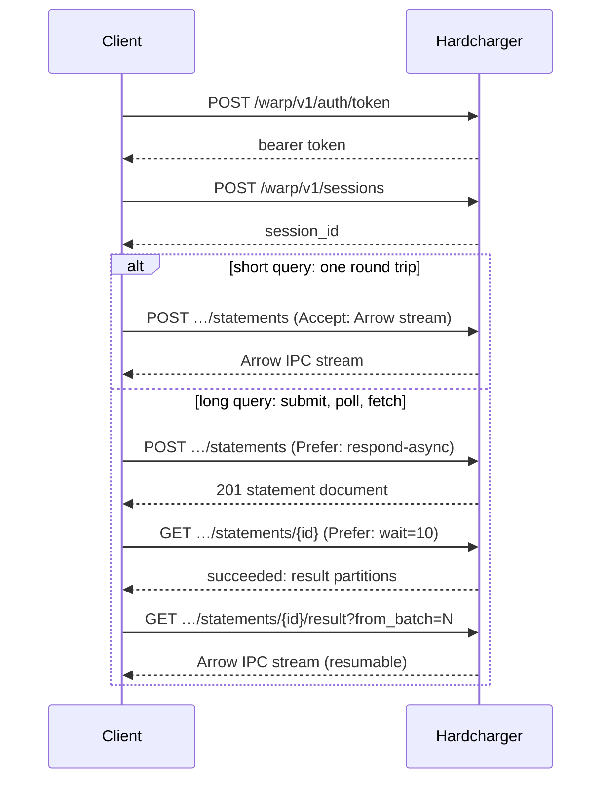

import { Aside } from '@astrojs/starlight/components';

Hardcharger speaks **Warp SQL**: an open protocol for running SQL over plain HTTP, with
results, parameters and uploads carried as [Apache Arrow IPC streams](https://arrow.apache.org/docs/format/Columnar.html#ipc-streaming-format).
Any HTTP client can call it. The drivers wrap it so you rarely see it, but knowing its shape
explains how Hardcharger behaves on real networks. The full specification is in the
[reference](/reference/warp-sql-protocol/).

## The pieces

| Thing | What it is | Endpoint |
|---|---|---|
| **Token** | A bearer credential the server issues for a password or an identity provider's token | `POST /warp/v1/auth/token` |
| **Session** | The server-side state of one connection: current catalog and schema, settings, temporary tables, an open transaction | `POST /warp/v1/sessions` |
| **Statement** | One run of one SQL statement in a session, with a state and, when it succeeds, a result | `POST …/sessions/{id}/statements` |
| **Result** | Arrow record batches, in one or more **partitions** | `GET …/statements/{id}/result` |
| **Prepared statement** | SQL parsed once, executed with Arrow parameter batches | `POST …/sessions/{id}/prepared` |
| **Ingest** | An Arrow stream written into a table | `POST …/sessions/{id}/ingest` |

Every handle (session, statement, prepared statement) belongs to the identity that created
it, and the server checks that on every request. Another user's session id gets the same
`404` as one that never existed.

## Two ways to run a statement



**Streamed.** One `POST` with `Accept: application/vnd.apache.arrow.stream` runs the query and
streams its rows back in the response. The schema goes out first, then batches as DuckDB
produces them. Statements without rows (DDL, `INSERT`) answer with a small JSON document
instead, so clients check `Content-Type`. This is the default in every driver: a short query
costs one round trip.

**Submit, poll, fetch.** With `Prefer: respond-async` the server answers at once with a
statement document (state `queued` or `running`). The client long-polls the statement with
`Prefer: wait=N` until it is `succeeded`, `failed` or `cancelled`, then reads the result. No
request has to stay open for the whole query, which matters behind proxies that cut idle
connections. The drivers switch to it with one option (`adbc.warp.statement.async`,
JDBC `async=true`).

## Retained, resumable results

A **retained** result stays on the server until it expires, and can be read again from any
batch. If a download breaks off, the client asks for the rest with `from_batch`:

```bash test
H='Content-Type: application/json'
TOKEN=$(curl -s localhost:31337/warp/v1/auth/token -H "$H" \
  -d '{"grant_type": "password", "username": "hardcharger", "password": "change-me"}' | jq -r .access_token)
SESSION=$(curl -s localhost:31337/warp/v1/sessions -H "Authorization: Bearer $TOKEN" -H "$H" -d '{}' | jq -r .session_id)
URL=localhost:31337/warp/v1/sessions/$SESSION

# Submit without waiting, and ask the server to keep the result.
STATEMENT=$(curl -s $URL/statements -H "Authorization: Bearer $TOKEN" -H "$H" \
  -H 'Prefer: respond-async' -H 'Warp-Retain-Result: true' \
  -d '{"sql": "SELECT * FROM range(1000000) t(i)"}' | jq -r .statement_id)

# Long-poll until it finishes (up to 10 s per request).
curl -s $URL/statements/$STATEMENT -H "Authorization: Bearer $TOKEN" -H 'Prefer: wait=10' \
  | jq -c '{state, partitions: .result.partitions}'

# Read the result from its fourth batch on, as a client resuming a broken download would.
curl -s "$URL/statements/$STATEMENT/result?from_batch=3" -H "Authorization: Bearer $TOKEN" -o rest.arrows
python3 -c "import pyarrow.ipc as ipc; print(ipc.open_stream('rest.arrows').read_all().num_rows)"
```

```text output
{"state":"succeeded","partitions":[{"index":0,"location":null,"batches":9,"rows":1000000}]}
631360
```

The million rows came in nine batches of up to 122,880 rows; batches 3 to 8 hold the last
631,360. An **unretained** result (the default for streamed queries) can be read once, from
the start, and costs the server no memory once read. The drivers resume retained results by
themselves (up to five times in the ADBC driver). A stream that ends without Arrow's
end-of-stream marker is never taken for a complete result: if a statement fails mid-stream,
the server cuts the stream short, and the client reports the error.

## Partitioned results

One TCP connection carries what one network flow allows (about 10 Gbit/s on AWS, much less
across regions). For a large result, a client can send `Warp-Result-Partitions: n`, and the
server may split the result into up to `n` partitions, which the client reads at once, each
over its own connection. The CLI asks for 8 by default; a result of fewer than two batches
still comes as one stream:

```python test
from adbc_driver_hardcharger import dbapi as hardcharger

with hardcharger.connect(uri="hardcharger://localhost?tls=false", username="hardcharger",
                         password="change-me",
                         db_kwargs={"adbc.warp.statement.result_partitions": "8"}) as conn:
    with conn.cursor() as cur:
        cur.execute(operation="SELECT i FROM range(10000000) t(i) ORDER BY i")
        table = cur.fetch_arrow_table()
        print(table.num_rows, table["i"][0], table["i"][-1])
```

```text output
10000000 0 9999999
```

With the default `result_order=preserve` the server deals batches to partitions round robin
(`interleaved`), and the driver takes them back in the same order, so `ORDER BY` holds. With
`any`, batches come in whatever order they arrive. Small results stay in one partition. A
client must read every partition, concurrently, to its end-of-stream marker before it treats
the result as complete. The JDBC driver's option is `resultPartitions`, and the CLI's is
`--result-partitions`.

## Partitioned uploads

Uploads go wide the same way (§8.3, capability `partitioned_ingest`): a client opens one ingest,
sends it as several parts at once over separate connections, and commits them as one. The
server inserts from every part in parallel, in one transaction, all or nothing. The rows land in
no defined order ([bulk ingest](/guides/bulk-ingest/#partitioned-uploads)).

<Aside type="tip" title="Why partitions are in the protocol">
Results are already described as partitions with a `location`. Today every partition lives on
the server you asked. A distributed engine can point partitions at other machines later,
without a protocol change.
</Aside>

## Cancel, close and timeouts

- `POST …/statements/{id}/cancel` stops a statement. A queued one never starts.
- `DELETE …/statements/{id}` says the client is done: a query still running is cancelled. A
  statement that changes data (`INSERT … RETURNING`) still runs to the end, with its rows
  discarded. Hardcharger never undoes a write because its reader left.
- `POST …/sessions/{id}/cancel` cancels everything the session is running, for a client
  that doesn't know a statement's id yet.
- `Warp-Statement-Timeout: <ms>` limits one statement; the server's
  [`query_timeout_seconds`](/reference/configuration/#query_timeout_seconds) sets a default.
- A client that hangs up while reading an unretained result cancels the query within a
  second.

The drivers map these to their APIs: `adbc_cancel()` and Ctrl-C in Python, `Statement.cancel()`
and `setQueryTimeout` in JDBC, Ctrl-C in the CLI.

## Safe retries

Every request that creates a statement or writes data carries an `Idempotency-Key`. If the
answer is lost and the client sends the same request again, the server answers with the
statement it already ran, so a retried `INSERT` doesn't insert twice. Reads and deletes are
retried after transport errors and `429`/`502`/`503`/`504`; commit and rollback never are.
An upload sent again is answered from the first one without its body being read, and the server
then reads and drops the rest of that body before closing (lingering close), so the answer reaches
the client instead of a reset connection.

## Sessions that disappear

A session idle for longer than [`session_idle_timeout`](/reference/configuration/#session_idle_timeout)
(15 minutes by default) is evicted. The server **never** recreates a session implicitly: the next
request gets `404 session_not_found`, because the session's temporary tables, settings and open
transaction are gone. The drivers open a new session, replay the options they set, and tell you
(a warning, and a counter on the connection). Inside a transaction they refuse to continue
instead, since half a transaction must not commit.

An administrator's `KILL SESSION`, a password change or a dropped or disabled user ends a
session. Its requests then get `401 session_ended` with a
[`reason`](/reference/errors/#session_ended-reasons) (`killed`, `credentials_changed`,
`principal_dropped`, `token_revoked`, `token_expired`); when access control ended it, the old
token gets `401 invalid_token` first, with the same
[`reason`](/reference/errors/#invalid_token-reasons). The client signs in again before it opens a
new session. A
`GET` of the ended session answers the same way, so a liveness probe sees it as gone.

## Errors

Errors are [RFC 9457](https://www.rfc-editor.org/rfc/rfc9457) problem documents with a stable
`code`, a human `detail`, and usually a SQLSTATE. A statement that has already failed when the
server answers its submission gets the error response itself (`500 execution_error`, ...), never a
success status with a `failed` statement document; a `failed` document comes only from polling a
statement that was still running, or from a replay of an idempotent request. Clients treat a
`failed` or `cancelled` document as the statement's error whatever the status code.

```console test
$ curl -s localhost:31337/warp/v1/sessions -H 'Authorization: Bearer not-a-token' -d '{}' | jq -c '{status, code}'
{"status":401,"code":"invalid_token"}
```

The [error code reference](/reference/errors/) lists every code and what to do about it.
