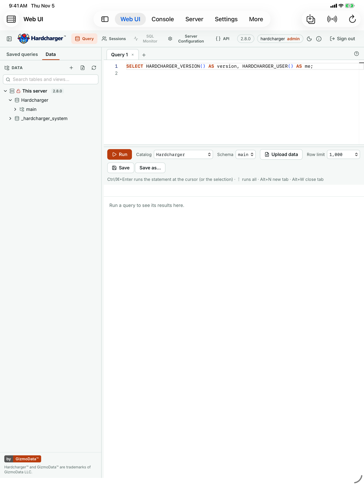

import iphoneConsole from '../../../assets/ios/ios-iphone-console-light.png';
import iphoneServer from '../../../assets/ios/ios-iphone-server-dark.png';
import iphoneShare from '../../../assets/ios/ios-iphone-share-light.png';
import { Image } from 'astro:assets';

**[Download on the App Store](https://apps.apple.com/us/app/hardcharger/id6824900180).**
Hardcharger runs the server directly on an iPhone or iPad: the same `hardcharger-server`,
Hardcharger Engine 2.0 and its built-in extensions, built into the app. It includes the web SQL
workspace and the `hardcharger` console, and connects to Hardcharger servers anywhere
else. Local queries do not require an account or a separate server.

<p class="store-badges">
  <a href="https://apps.apple.com/us/app/hardcharger/id6824900180"></a>
</p>

<p class="ios-screens" style={{display: "flex", gap: "0.75rem", flexWrap: "wrap"}}>
  <Image src={iphoneConsole} alt="The Hardcharger app on iPhone: the native SQL console with a TPC-H query and its table" width={196} style={{margin: 0}} />
  <Image src={iphoneServer} alt="The Hardcharger app on iPhone, dark: the server running on the phone, with its port, uptime and buttons" width={196} style={{margin: 0}} />
  <Image src={iphoneShare} alt="Share on Local Network: the address as a QR code for a computer on the same Wi-Fi" width={196} style={{margin: 0}} />
</p>

## Install and open

The app needs iOS 18 or later and runs on iPhone and iPad. Install it from the
[App Store](https://apps.apple.com/us/app/hardcharger/id6824900180); the
[install page](https://gizmodata.com/hardcharger/install) links it too. Developers can build
it from the [iOS source instructions](https://github.com/gizmodata/hardcharger/blob/main/ios/README.md).

The app has six screens: **Web UI**, **Console**, **Server**, **Logs**, **Servers** and
**Settings**. On iPhone they are in a tab bar. On iPad they are in a sidebar, with keyboard
shortcuts (⌘1–⌘6 for the screens, ⌘I to import, ⌘⇧L for sharing, ⌘R to reload), multiple
windows and Stage Manager.

On first launch the app creates the administrator's password and the server's token-signing
key and keeps them in the Keychain, on this device only. The web UI opens already signed in.



## Run queries and work with files

In **Web UI** or **Console**, try:

```sql
SELECT 'Hello from iPhone' AS message, 42 AS answer;
```

**Web UI** is the server's own web UI: the editor, results grid, schema browser, sessions,
API page and uploads. The [web UI guide](/guides/web-ui/) describes it.

**Console** is the `hardcharger` command-line client inside the app, with the same statement
endings, dot commands (`.help`, `.tables`, `.schema`, `.mode`, `.timer`, `.maxrows` and the
rest) and output formatting. Return runs a statement once it ends with `;`; ↑/↓ recall
history. On iPad, ⌘↩ runs, Esc clears the input, ⌘. cancels and ⌘K clears the output.
`.shell` is not available, because iOS does not let an app start other programs.

Import CSV, TSV, JSON and Parquet files from the Files app, the share sheet, or by dropping
them on the app on iPad. The database is `Hardcharger.duckdb` in the app's documents, with
`Imports` and `Exports` folders beside it, all visible in the Files app under
**On My iPhone › Hardcharger** (or **On My iPad**).

**Server** starts, stops and restarts the server and shows its address, uptime, versions,
database size and memory. **Logs** shows the server's log, with level marks or plain.

## Connect to another server

Add a server under **Servers**. Sign in with a user name and password, or with the server's
single sign-on through [browser sign-in](/guides/sso/). Saved servers and their credentials
are kept in the Keychain. Their web UI and console work like the device's own.

A server with a self-signed certificate is trusted only by its fingerprint, and only after
you approve it. See [TLS](/guides/tls/) for server configuration.

## Share the local server

**Share on Local Network** is off by default. Turn it on and the server listens on the
network with TLS, using a certificate the device makes for itself. The app shows the
address as a QR code, with the certificate's fingerprint, so a computer on the same Wi-Fi
can open the web UI and sign in with the administrator's password. A second QR code adds
the server to another iPhone or iPad's Hardcharger app.

iOS suspends apps that leave the screen. The app asks for the usual extra time so running
statements finish, and when you return it restarts a server that no longer answers. Keep
the app on screen while another device uses its server; **Settings › Share on Local Network**
can keep the screen on while sharing.

## Included extensions

DuckDB's extensions are built into the app. iOS runs only code the app was signed with, so
the app cannot download or load other extensions, and changing extension settings does not
change that. See [DuckDB extensions](/guides/extensions/) for the platform differences.
