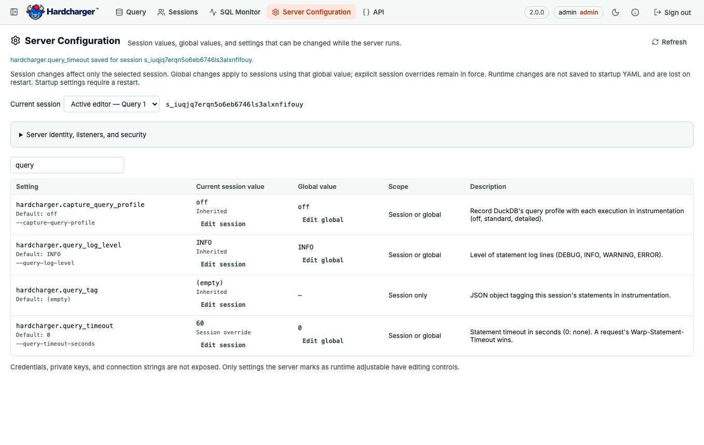

**Available in v2.1.0+.** Open **Server Configuration** in the SQL Editor web UI, served
with `--web-ui`, or in the [desktop SQL workspace](/guides/desktop-app/). Sign in as an
unrestricted administrator. Instrumentation is not required. Tenant administrators,
regular users and administrator tokens limited by `catalog_access` cannot view or edit
these settings; the server enforces this permission.

`/ui/configuration` shows the selected session's effective value, explicit override
versus inheritance, global value, documented default, allowed scopes, startup flag and
description. Select the active editor's session or the workspace session; the session ID
is always visible. Each editor tab owns a separate session. A tab becomes available here
after its first query opens that session.

**Edit session** changes only that session. **Edit global** changes the server-wide value
used by sessions without an explicit override. **Reset session override** restores inheritance;
**Reset to startup value** restores the server's configured startup value, which may differ
from the built-in default. Only supported runtime scopes have editing controls. Startup
settings remain read-only and need a restart. Runtime changes are not written to YAML and
are lost on restart. Credentials, private keys and secret-bearing connection strings are
not included; this is not a full YAML configuration export.

Session reads and edits use `hardcharger_session_settings(session_id)`,
`hardcharger_set_session_setting(session_id, name, value)` and
`hardcharger_reset_session_setting(session_id, name)`. These require an unrestricted
administrator and reuse the server's setting validators. They access the target's locked
settings directly, without issuing SQL inside its transaction or waiting behind its active
or queued statement. Mutation functions are volatile and do not act during PREPARE or
EXPLAIN. Global changes use existing `SET GLOBAL` and `RESET GLOBAL` on the observer
connection. Both caller and target are recorded in the session-change audit log.

For persistent startup changes, edit your [YAML, environment or flags](/guides/configuration/),
or save options in the desktop app’s Settings screen, then restart. The web tab does not
export or import a complete YAML configuration. Monitor active work and cancel or end
sessions with [SQL Monitor](/guides/sql-monitor/).
