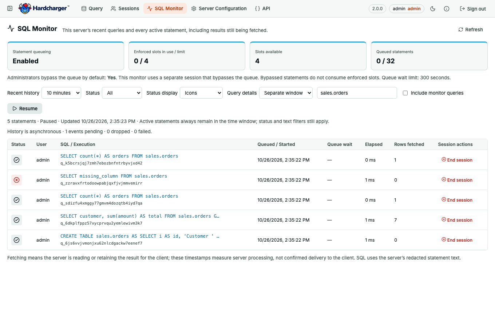

**Available in v2.1.0+.** SQL Monitor is part of the server’s SQL Editor web UI, available
in a browser with `--web-ui` and in the [desktop SQL workspace](/guides/desktop-app/).

Start the server with `--enable-instrumentation`, open `/ui/`, and sign in as an
unrestricted administrator. **SQL Monitor** refreshes every two seconds. Without
instrumentation its navigation item is disabled; `/ui/monitor` explains how to enable it.
[Server Configuration](/guides/server-configuration/) is available even when instrumentation is disabled.

The server enforces both pages' permissions. A regular user, tenant administrator, or
administrator token limited by `catalog_access` cannot call the underlying administrative
functions. `HARDCHARGER_IS_FULL_ADMIN()` reports the caller's capability; UI navigation
uses it too. Each page has its own observer session with queue bypass explicitly enabled,
so it stays usable when all normal statement slots are occupied and never enters an
editor's transaction. That session closes when the page is left.

## Reading SQL Monitor

- **Queued**: waiting for a concurrency slot. **Executing**: admitted, before its first
  result batch. **Fetching**: the server has fetched a batch and still holds the result.
  All three remain visible regardless of the selected time window.
- **Succeeded**, **Failed**, **Cancelled**, **Execution timed out**, and **Queue timed out**
  describe completed attempts. The time window applies to completion time, so a query
  that started hours ago and just finished still appears in the default ten-minute window.
- The queue cards show whether queueing is enabled, enforced slots in use and available,
  queued statements, and capacity. Zero concurrency limit means unlimited concurrency;
  zero queue capacity means an unbounded queue. Administrators may bypass slots; those
  statements are visible but do not consume the enforced slot count. Lowering a live limit
  can leave more slots in use than the new limit until existing work finishes.
- Choose 1 minute through 24 hours, filter by status or SQL/user/execution ID, pause
  automatic refresh, or click SQL for its full redacted text, identifiers, row count,
  timeline, cancellation reason, and error. Time filters always retain active work;
  explicit status and text filters still apply. Monitor queries are hidden by default.
- History starts with the most recent 1,000 recorded completions (plus a lookahead row
  and recent live completions); **Load 1,000 more completions** expands it. Active work is
  never subject to that cap. This page monitors this server instance, including with a
  shared PostgreSQL instrumentation catalog.

`hardcharger_live_queries()` is a synchronous snapshot independent of the asynchronous
history writer. It retains every active execution and the most recent 2,048 completions (up to 16 MiB, excluding query profiles)
to bridge write latency. The page merges it with the instrumentation `execution_details`
view by execution ID, preferring live state. `hardcharger_monitor_info()` provides a
consistent snapshot of queue counts plus instrumentation backlog, dropped and failed
event counters. Loss counters mean persisted history may be incomplete; the live
snapshot still shows active statements. State and queue counts are separate samples,
so a statement may finish between them.

The existing instrumentation timeline measures server processing, not proof of client
delivery. A result handle can be produced before its rows are evaluated. Fetch start is
the first batch fetched by the server, fetch end its final batch, and cursor close the
result's release. Streaming network delivery may continue after the server has fetched
the rows. The monitor cannot measure how long a client spends using downloaded data.
SQL text uses the same redaction and abbreviation rules as the query log.

### Captured query profiles

Click SQL to open a separate **Query details** window by default. Each window follows
that execution and refreshes every two seconds, independently of the monitor's filters,
recent-history cutoff, and original workspace. Its captured profile and JSON download
remain available after reloading the window. Choose **Query details → Below monitor**
for the inline layout; its **Pop out** button moves the current inspection to a window.
The layout preference is remembered. Browsers that block the pop-up show a notice and
fall back to inline details. The desktop app opens native inspector windows; stopping
or restarting its server closes the workspace and all inspectors.

Each inspector opens its own observer sessions and enforces the same unrestricted
administrator permission. It uses the existing short-lived sign-in in session storage;
credentials are never put in the detail URL or local storage. Closing the inspector
ends its own sessions without touching the monitored query or editor sessions.

Select a statement to retrieve its existing `query_profile` from instrumentation for that
execution ID and this server instance. The UI never reruns the statement or issues an
`EXPLAIN ANALYZE`. With `hardcharger.capture_query_profile` set to `standard` or `detailed`
for the original execution, its details show the operator tree, actual/estimated rows,
operator times, scan counts, query and CPU times, memory and I/O, and every other captured
metric group (optimizer, parser and planning metrics when present). Units come from the
server's `duckdb_available_metrics()` metadata; missing metrics remain missing, while zero
measurements are shown as zero. See [DuckDB 2.0 metrics](https://duckdb.org/docs/2.0/dev/metrics).

Profiles are fetched only for the selected statement, after its result closes and the
instrumentation writer records it. A pending profile is retried automatically. Completed
executions without a profile are labeled clearly; changing capture settings cannot produce
profiles retroactively. The current global capture setting is shown as context, since the
execution's session may have overridden it. Operator times can overlap with parallel work
and are not percentages of total elapsed time. All raw JSON can be inspected or downloaded
verbatim. Observer sessions disable their own profile capture to avoid profiling the monitor.

**Status display** chooses **Icons** (the default) or **Descriptions**, remembered in this
browser. Every icon has a tooltip and accessible name. Executing statements have a spinning
circle in both modes; reduced-motion preferences disable its animation.

## Cancel work or end a session

**Cancel work** cancels all queued and in-flight work in the selected statement's session,
including fetching, and keeps the session connected. It uses `hardcharger_cancel(session_id)`;
it is deliberately a session-work action, not a promise to cancel only one execution ID.
**End session** uses `KILL SESSION` to cancel work and disconnect that session (an open
transaction is rolled back). Both actions ask for confirmation identifying the user and
session. The monitor cannot cancel or end its own observer session, and ended sessions have
disabled controls. A statement that finishes before cancellation produces a clear "no active
work remained" response. The server enforces its existing session-control permissions.
