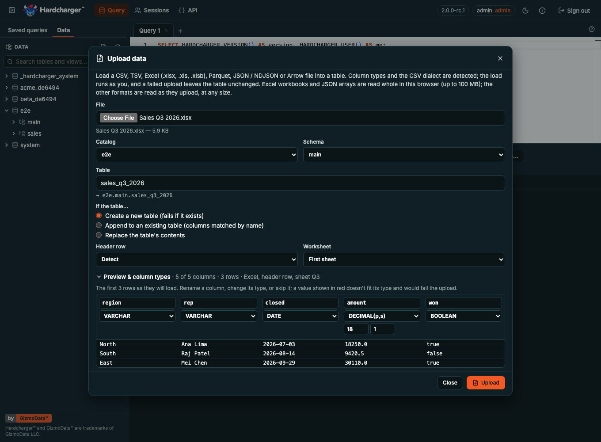

import { Aside, Tabs, TabItem } from '@astrojs/starlight/components';

Hardcharger has a web UI compiled into `hardcharger-server`. There is nothing extra to install:
the server serves it at `/ui` on its own port, with its own TLS certificate, and the page
talks [Warp SQL](/concepts/warp-sql/) back to the same origin. It is off by default.


- **SQL editor**: Ctrl/⌘+Enter runs the statement under the cursor, or the selection. Each tab
  has its own server session, and **Cancel** stops the statement on the server.
- **Results grid** for up to a million rows, with DuckDB's own formatting of every type.
  Ctrl/⌘+C copies the selected cells as tab-separated text in every browser, Safari included.
- **Schema browser**: catalogs, schemas, tables, views and columns with their types, filtered
  by access control. Preview a table in a new tab, or double-click a name to insert it.
- **Exports** to CSV, TSV, JSON (numbers kept exact) and Parquet, written in the browser.
- **Upload data**: a CSV, TSV, Excel, Parquet, JSON or Arrow file into a table, read in the
  browser and sent over [bulk ingest](/guides/bulk-ingest/) ([below](#upload-data)).
- **Sessions**: the sessions you may see, and, for an administrator, a button that ends one.
- **About**: the server's version, protocol and capabilities, and when your sign-in expires.

## Turn it on

The option is `web_ui`: the `--web-ui` flag, `HARDCHARGER_WEB_UI=true`, or `web_ui: true` in
the YAML file, like [every other option](/guides/configuration/).

<Tabs syncKey="config">
<TabItem label="Flag">

```bash test server=self background
HARDCHARGER_ADMIN_PASSWORD='change-me' hardcharger-server --database my.duckdb --web-ui --health-port 31338
```

</TabItem>
<TabItem label="Environment">

```bash test server=self background stop
HARDCHARGER_WEB_UI=true HARDCHARGER_ADMIN_PASSWORD='change-me' \
  hardcharger-server --database my.duckdb --health-port 31338
```

</TabItem>
<TabItem label="YAML">

```yaml test file=hardcharger.yaml server=none
# hardcharger.yaml
database: my.duckdb
health_port: 31338
web_ui: true
```

```bash test server=self background stop
HARDCHARGER_ADMIN_PASSWORD='change-me' hardcharger-server --config hardcharger.yaml
```

</TabItem>
</Tabs>

Open [http://localhost:31337/ui](http://localhost:31337/ui) and sign in as `hardcharger` / `change-me`. The server logs
where the UI is when it starts (`the web UI is on url=…`), and the page answers:

```console test server=none
$ curl -s -o /dev/null -w '%{http_code}\n' http://localhost:31337/ui/
200
```

Without `web_ui`, nothing answers under `/ui`: the server's usual `404`, as for any path that
isn't Warp SQL.

```bash test server=self background stop
HARDCHARGER_ADMIN_PASSWORD='change-me' hardcharger-server --database my.duckdb --health-port 31338
```

```console test server=none
$ curl -s -o /dev/null -w '%{http_code}\n' http://localhost:31337/ui/
404
```

## Signing in

The sign-in page uses the server's own sign-in: the user name and password go once to
`POST /warp/v1/auth/token`, and the page keeps only the short-lived access token, in memory
and in that tab's session storage (so a reload stays signed in). It never writes a credential
to `localStorage` or a cookie. When the token expires, or an administrator ends the session
(`KILL SESSION`), the page goes back to the sign-in form and says why.


## With TLS

With [`--tls-cert` and `--tls-key`](/guides/tls/), the UI is served over HTTPS with the same
certificate as Warp SQL, at `https://<host>:31337/ui`. For a quick local try, a self-signed
certificate for `localhost` is enough (the browser will ask you to accept it):

```bash test server=none
openssl req -x509 -newkey ec -pkeyopt ec_paramgen_curve:prime256v1 -nodes -days 30 \
  -subj /CN=localhost -addext subjectAltName=DNS:localhost -keyout server.key -out server.pem
```

```bash test server=self background stop
HARDCHARGER_ADMIN_PASSWORD='change-me' hardcharger-server --database my.duckdb --web-ui \
  --tls-cert server.pem --tls-key server.key --health-port 31338
```

```console test server=none
$ curl -s --cacert server.pem -o /dev/null -w '%{http_code}\n' https://localhost:31337/ui/
200
```

## With mutual TLS

Under [mutual TLS](/guides/tls/#mutual-tls) (`--mtls-ca-cert`), the server completes a TLS handshake only with a client
that presents a certificate it accepts, and a browser is a client like any other: it must
present such a certificate before it can load `/ui` at all. Install the certificate and its key
in the browser, or in the system's keychain or certificate store (most browsers take a PKCS#12
file), and the browser offers it when the page opens.

With certificate sign-in on (`--mtls-certificate-sign-in`), the sign-in page also shows **Sign in with my
certificate**: it signs in as the certificate's identity with no password, and the token it
gets is bound to that certificate. Every request the page makes carries the certificate, so the
bound token works throughout. With `--mtls-require-client-cert=false` the page loads without a
certificate, and password sign-in works as usual.

A throwaway CA, a server certificate, and a client certificate for `ops@example.com` (the
identity is the certificate's e-mail address by default), packed for a browser:

```bash test server=none
openssl req -x509 -newkey ec -pkeyopt ec_paramgen_curve:P-256 -nodes -days 30 \
  -subj "/CN=Example CA" -keyout ca.key -out ca.crt
openssl req -newkey ec -pkeyopt ec_paramgen_curve:P-256 -nodes -subj "/CN=localhost" \
  -keyout server.key -out server.csr
openssl x509 -req -in server.csr -CA ca.crt -CAkey ca.key -CAcreateserial -days 30 \
  -extfile <(printf 'subjectAltName=DNS:localhost,IP:127.0.0.1') -out server.crt
openssl req -newkey ec -pkeyopt ec_paramgen_curve:P-256 -nodes -subj "/CN=Ops" \
  -keyout client.key -out client.csr
openssl x509 -req -in client.csr -CA ca.crt -CAkey ca.key -CAcreateserial -days 30 \
  -extfile <(printf 'extendedKeyUsage=clientAuth\nsubjectAltName=email:ops@example.com') -out client.crt
# For the browser: the client certificate and its key in one file.
openssl pkcs12 -export -in client.crt -inkey client.key -out client.p12 -passout pass:change-me
```

```bash test server=self background stop
HARDCHARGER_ADMIN_PASSWORD='change-me' hardcharger-server --database my.duckdb --web-ui \
  --tls-cert server.crt --tls-key server.key --mtls-ca-cert ca.crt \
  --mtls-certificate-sign-in --mtls-admin-identities ops@example.com --health-port 31338
```

Import `client.p12` (password `change-me`) into the browser and open
[https://localhost:31337/ui](https://localhost:31337/ui). Without the certificate, there is no page:

```console test server=none
$ curl -s --cacert ca.crt -o /dev/null https://localhost:31337/ui/ || echo "refused at the handshake"
refused at the handshake
$ curl -s --cacert ca.crt --cert client.crt --key client.key -o /dev/null -w '%{http_code}\n' https://localhost:31337/ui/
200
```

**Sign in with my certificate** makes the same request this does, on the same connection:

```console test server=none
$ curl -s --cacert ca.crt --cert client.crt --key client.key -X POST -H 'Content-Type: application/json' \
    -d '{"grant_type": "client_certificate"}' https://localhost:31337/warp/v1/auth/token | jq -r .token_type
Bearer
```

## Upload data

**Upload data** loads a file into a table: the button in the query toolbar, the one in the
schema browser's header (or **Upload data…** on a catalog's or schema's menu, which picks that
catalog and schema), or a file dropped anywhere on the page. It reads:

| Format | Extensions | Read |
|---|---|---|
| CSV, TSV | `.csv` `.tsv` `.tab` `.txt` | as it uploads, any size |
| Excel | `.xlsx` `.xls` `.xlsb` | whole, up to 100 MB |
| Parquet | `.parquet` `.pq` | as it uploads, row group by row group |
| JSON | `.json` `.ndjson` `.jsonl` | JSON lines as it uploads; a JSON array whole, up to 100 MB |
| Arrow IPC | `.arrows` `.arrow` `.feather` `.ipc` | a stream as it uploads; a file whole, up to 1 GB |



The dialog asks for the **Catalog** and **Schema** (or **New schema…**), the **Table** (named
after the file: `Sales Q3 2026.xlsx` becomes `sales_q3_2026`), and what to do **If the table…**:

- **Create a new table (fails if it exists)**.
- **Append to an existing table (columns matched by name)**: the file's columns go into the
  table's columns of the same name, in any case and any order. A table column the file lacks
  gets `NULL`; a file column the table lacks stops the upload before it starts (rename or skip
  it). Each value is converted to its column's type; one that can't be fails the upload.
- **Replace the table's contents**: the table takes the file's columns and rows.

For CSV it detects the **Header row** and the **Delimiter** (comma, semicolon, tab or `|`; type
another of up to four characters, or `\t` for a tab), quotes and line breaks inside quotes. The
text is read as UTF-8, or UTF-16 with a byte order mark; a file that is neither is read as
Windows-1252, and the dialog says so. For Excel, pick the **Worksheet** (the first by default)
and the **Header row**. Dates and times come from the cells' number formats, in the workbook's
own date system (1900, or 1904 for old Mac workbooks); a formula loads the value Excel saved
with it (nothing is calculated, and no macro runs); error cells (`#N/A`, `#DIV/0!`) are `NULL`;
empty rows are left out; a merged range's value is in its first cell. A number stored as text
stays text, so `00123` keeps its zeros.

**Preview & column types**, folded away until you open it, shows the first 100 rows as they
will load, and each column's type, inferred from the first 20,480 rows: change it (VARCHAR,
BIGINT, DOUBLE, DECIMAL(p,s), BOOLEAN, DATE, TIMESTAMP, TIMESTAMPTZ, TIME), rename the column,
or skip it. A value that wouldn't fit its type is shown in red. Parquet and Arrow columns keep
the file's own types.

The upload runs as you, with the editor tab's **Run as** role, in a session of its own and
**one transaction**: the file goes to the server in pieces of a few megabytes, one
[bulk-ingest](/guides/bulk-ingest/) request each, in the file's order, and nobody sees the rows
until it commits. **Cancel upload**, a value that doesn't convert, or a refusal from the server
rolls everything back and leaves the table as it was. The server never stores the file: the
browser reads it (in a Web Worker, so even a large or malformed file can't freeze the page) and
sends Arrow. Errors say where: `Cell C12, column "amount": "n/a" is not a whole number`, or
`Line 1,234 has 5 fields, but the file's first line has 4`. With access control, uploading
needs the same privileges as SQL: `CREATE` on the schema for a new table, `INSERT` on the table
to append, and [row policies](/guides/row-policies-and-masking/) apply. A refusal is shown as
the server words it.

When it's done, the dialog says how many rows went in, the mode, the format and how long it
took, and lists the table's columns; **Query this table** opens a tab with
`SELECT * FROM … LIMIT 100`, and the schema browser shows the table.

Excel workbooks are read with [SheetJS Community Edition](https://git.sheetjs.com/sheetjs/sheetjs)
(Apache-2.0), part of the UI's build like everything else on the page, and loaded only when a
file is read.

## Content-Security-Policy

Every answer under `/ui` carries a strict Content-Security-Policy and the usual security
headers. Nothing loads from another origin: the scripts, the editor's and the upload's
workers, the styles, the fonts (Inter is part of the build) and the Parquet reader's and
writer's WebAssembly are all files under `/ui/`, and the page talks only to its own origin.

```bash test server=self background stop
HARDCHARGER_ADMIN_PASSWORD='change-me' hardcharger-server --database my.duckdb --web-ui --health-port 31338
```

```console test server=none
$ curl -sI http://localhost:31337/ui/ | grep -i -e '^content-security-policy' -e '^x-frame-options' -e '^x-content-type-options' -e '^referrer-policy' -e '^cross-origin'
Content-Security-Policy: default-src 'self'; script-src 'self' 'wasm-unsafe-eval'; worker-src 'self'; style-src 'self' 'unsafe-inline'; img-src 'self' data:; font-src 'self'; connect-src 'self'; object-src 'none'; base-uri 'none'; form-action 'self'; frame-ancestors 'none'
X-Content-Type-Options: nosniff
Referrer-Policy: no-referrer
X-Frame-Options: DENY
Cross-Origin-Opener-Policy: same-origin
Cross-Origin-Resource-Policy: same-origin
```

What the policy allows beyond `'self'`, and why:

| Directive | Why |
|---|---|
| `script-src 'wasm-unsafe-eval'` | The Parquet export and Parquet uploads compile WebAssembly. It allows WebAssembly only, never `eval` of JavaScript. |
| `style-src 'unsafe-inline'` | The editor sets styles at run time (`<style>` elements and style attributes). |
| `img-src data:` | Two small images in the editor's stylesheet. |

The page can't be framed (`frame-ancestors 'none'`, `X-Frame-Options: DENY`). If a proxy in
front of Hardcharger adds a policy of its own, browsers apply both, so it must allow at least
this much, or parts of the page stop working.

<Aside>
Files under `/ui/assets/` have a content hash in their names and are cached for a year;
`index.html` is revalidated on every load, so an upgrade reaches open tabs. A tab opened before
an upgrade that asks for a file the new build doesn't have reloads itself, and then says a new
version is available. Files are sent gzipped to browsers that accept it.
</Aside>

## What access control shows

The page shows each user what the server lets that user see, because every list in it comes
from the server, as that user. With [access control](/guides/access-control/) on:

- The **schema browser** lists only the catalogs, schemas, tables, views and columns the user's
  roles have a privilege on. What a user can't see isn't there, not even its name. With
  [catalog access rules](/guides/catalog-access-rules/), a tenant's users see their catalog
  only.
- **Queries** run as the user, so a statement the user's grants don't allow fails with the
  server's message, and [row policies and masking](/guides/row-policies-and-masking/) apply to
  every result and export.
- **Sessions**: an administrator sees every session and can end one (`KILL SESSION`); everyone
  else sees their own. A user whose sessions an administrator ends is sent back to sign in.

The page has no permissions of its own to configure: grant and revoke as usual, and the next
refresh of the schema browser shows the change.
