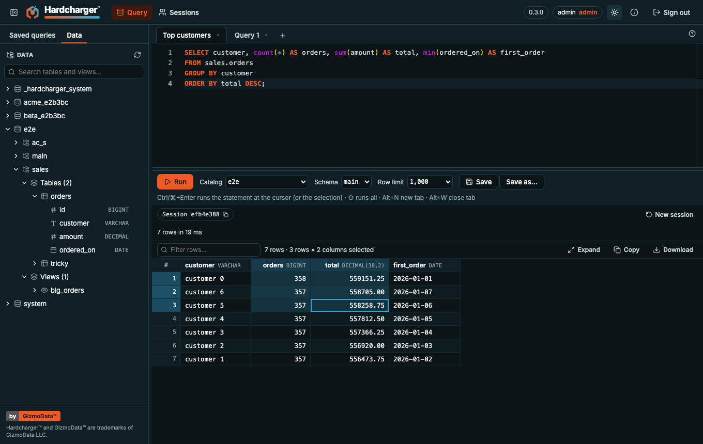
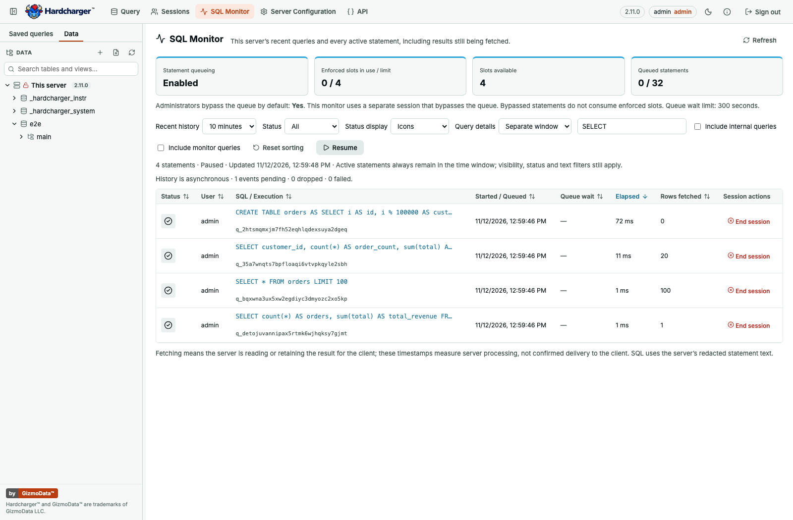
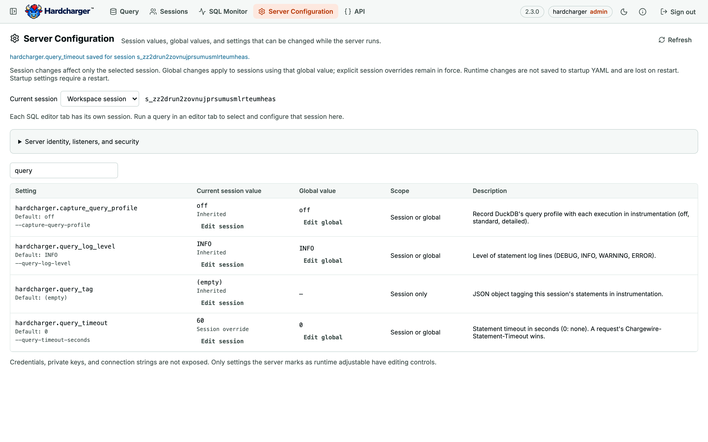
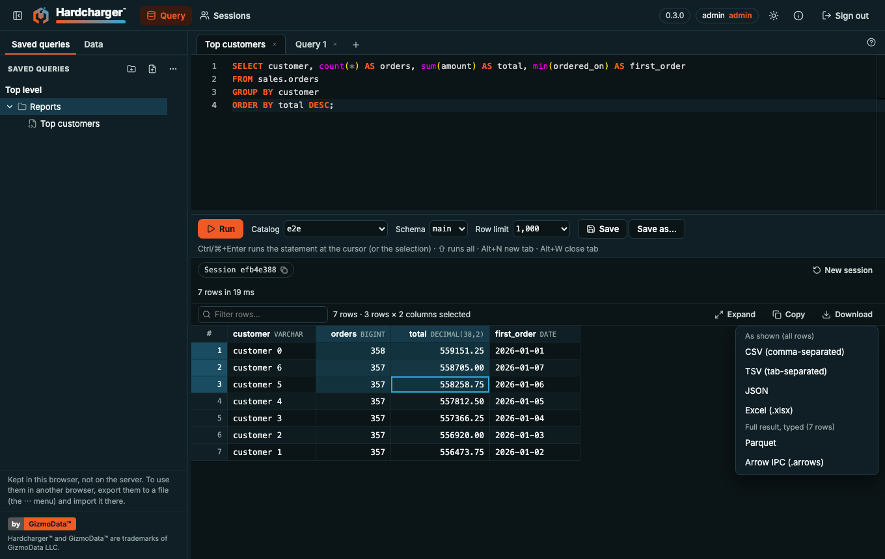
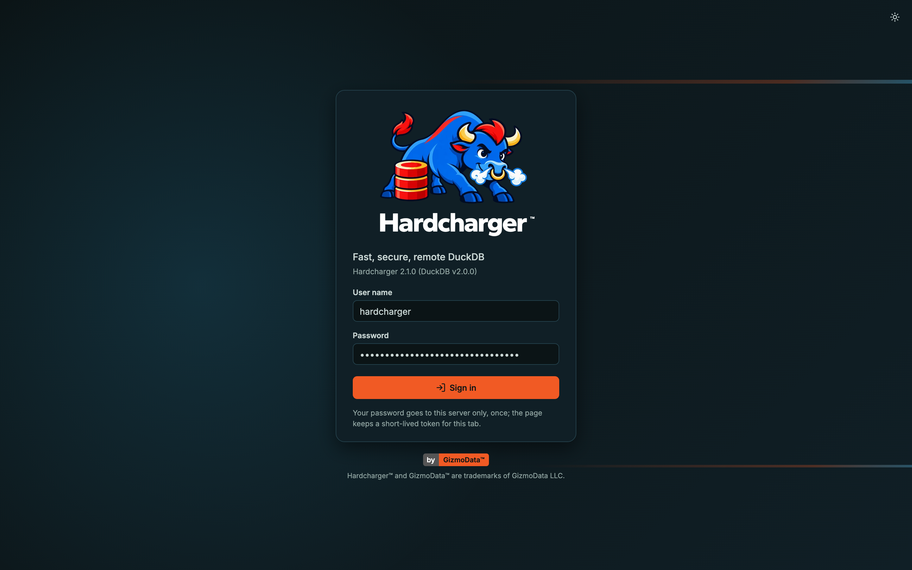
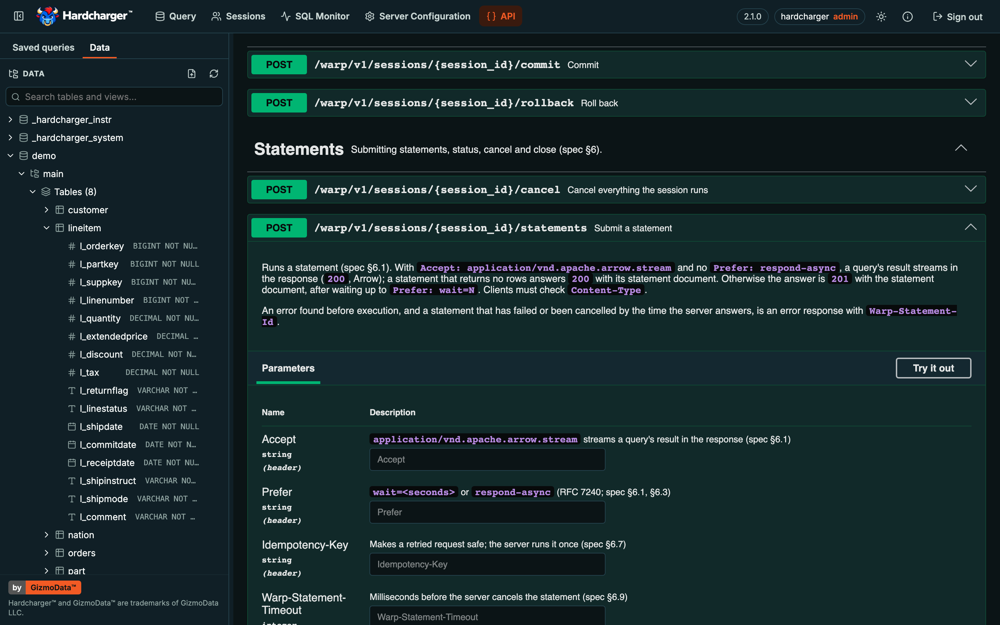
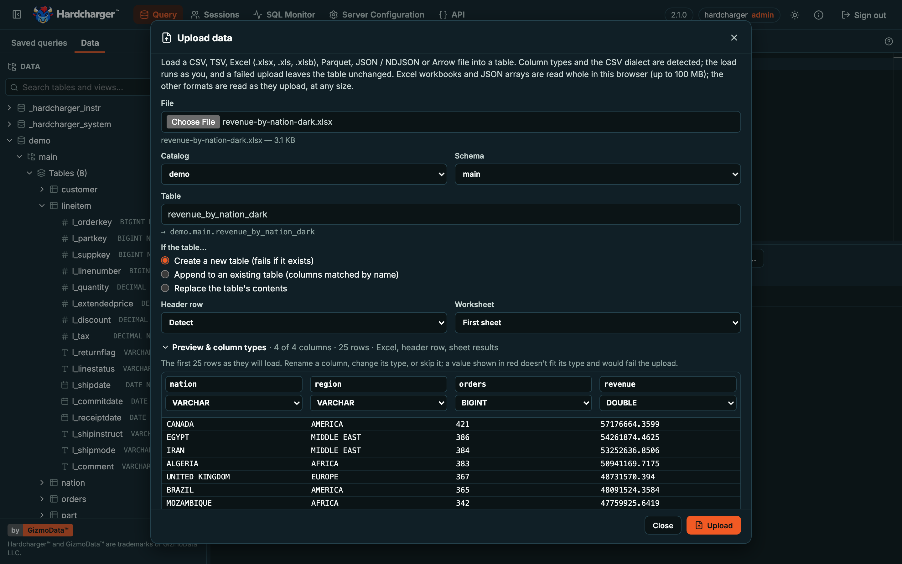
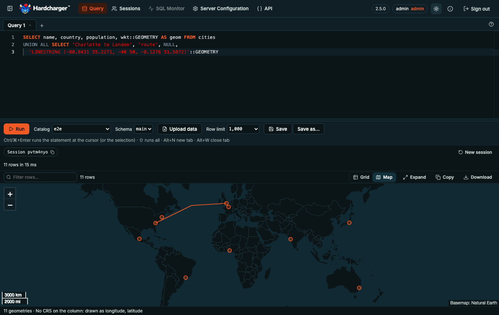
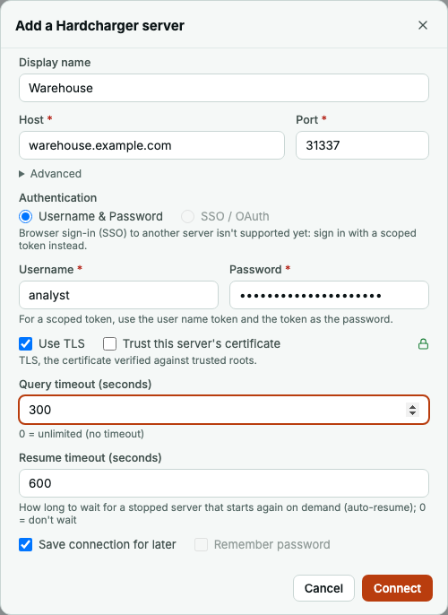

import { Aside, Tabs, TabItem } from '@astrojs/starlight/components';

Hardcharger has a web UI compiled into `hardcharger-server`. There is nothing extra to install:
the server serves it at `/ui` on its own port, with its own TLS certificate, and the page
talks [Chargewire](/concepts/chargewire/) back to the same origin. It is off by default.



- **SQL editor** in tabs (up to 20), each with its own server session, so a long query or an
  open transaction in one tab never touches another. Ctrl/⌘+Enter runs the statement under the
  cursor (a bar in the margin marks it) or exactly the selection; Shift+Ctrl/⌘+Enter runs them
  all, with a result tab for each result set and **Messages**. **Cancel** stops the statement
  on the server. An open or failed transaction shows as a badge with **Commit** and
  **Rollback**.
- **Results grid** for up to a million rows, with DuckDB's own formatting of every type: sort
  (NULLs last), filter, resize columns, and select cells like a spreadsheet. Ctrl/⌘+C copies
  the selection so that a paste into Excel or Google Sheets lands as cells, in every browser,
  Safari included.
- **Schema browser and autocomplete**: catalogs, schemas (nested ones as a tree, v2.7.0+),
  tables, views and columns with their types, as access control lets the user see them.
  Double-click or drag a name into the editor, preview a table in a new tab, show a view's
  definition, search every table and view by name.
- **Other servers (v2.7.0+)**: add other Hardcharger servers to the schema browser, sign in to
  each, and query them from tabs bound to them; a lock beside each server says how the
  connection is protected ([below](#other-servers)). A server that is starting again on demand
  (auto-resume) is waited for, v2.8.0+ ([below](#a-server-that-is-resuming)). The same UI runs
  on its own, without a server behind it, as `hardcharger ui` ([below](#the-ui-on-its-own)).
- **Saved queries** in folders, kept in the browser (see [below](#what-stays-in-the-browser)).
- **Run as**: under access control, a tab acts with one of the user's roles, or all of them.
- **Downloads**: CSV, TSV, JSON and Excel (.xlsx) of the rows as shown, Parquet and Arrow IPC
  of the whole result with its exact types, all written in the browser.
- **Geometry and maps (v2.5.0+)**: `GEOMETRY` values as WKT, and a **Map** view of the rows
  shown, on a world basemap that ships with the UI ([below](#geometry-and-maps)).
- **Upload data**: a CSV, TSV, Excel, Parquet, JSON or Arrow file into a table, read in the
  browser and sent over [bulk ingest](/guides/bulk-ingest/) ([below](#upload-data)).
- **Sessions**: the sessions you may see, and, for an administrator, a button that ends one.
- **SQL Monitor (v2.1.0+)**: unrestricted administrators see queued, executing and fetching
  queries, recent successes, failures and timeouts, queue status and free statement slots.
  Captured profiles and query details open in their own windows. Requires instrumentation;
  see [SQL Monitor](/guides/sql-monitor/).
- **Server Configuration (v2.1.0+)**: unrestricted administrators inspect the selected
  editor session's effective values alongside global values, then edit or reset settings
  at supported runtime scopes. Startup settings identify when a restart is required.
  See [Server Configuration](/guides/server-configuration/).
- **API**: the server's Chargewire API in Swagger UI, where **Try it out** runs requests as you.
- **About**: the server's version, protocol and capabilities, and when your sign-in expires.
  **How the editor works** (the **?** at the end of the tab bar) sums up sessions,
  transactions, statements and results, with this server's session idle timeout.

The editor and the side panel resize (drag the bar between them, or focus it and use the arrow
keys; double-click for the default size). On a phone-sized screen the side panel sits above the
editor and the page scrolls.

The administrator tabs run in both browser sessions served by `--web-ui` and the
[desktop app's SQL workspace](/guides/desktop-app/). Server permissions determine access.
SQL Monitor is disabled without `enable_instrumentation`; Server Configuration does not
need instrumentation. **API** is the final navigation tab in v2.1.0+.







## Turn it on

The option is `web_ui`: the `--web-ui` flag, `HARDCHARGER_WEB_UI=true`, or `web_ui: true` in
the YAML file, like [every other option](/guides/configuration/).

<Tabs syncKey="config">
<TabItem label="Flag">

```bash test server=self background
HARDCHARGER_ADMIN_PASSWORD='change-me' hardcharger-server --database my.duckdb --web-ui --health-port 31338
```

</TabItem>
<TabItem label="Environment">

```bash test server=self background stop
HARDCHARGER_WEB_UI=true HARDCHARGER_ADMIN_PASSWORD='change-me' \
  hardcharger-server --database my.duckdb --health-port 31338
```

</TabItem>
<TabItem label="YAML">

```yaml test file=hardcharger.yaml server=none
# hardcharger.yaml
database: my.duckdb
health_port: 31338
web_ui: true
```

```bash test server=self background stop
HARDCHARGER_ADMIN_PASSWORD='change-me' hardcharger-server --config hardcharger.yaml
```

</TabItem>
</Tabs>

Open [http://localhost:31337/ui](http://localhost:31337/ui) and sign in as `hardcharger` / `change-me`. The server logs
where the UI is when it starts (`the web UI is on url=…`), and the page answers:

```console test server=none
$ curl -s -o /dev/null -w '%{http_code}\n' http://localhost:31337/ui/
200
```

Without `web_ui`, nothing answers under `/ui`: the server's usual `404`, as for any path that
isn't Chargewire.

```bash test server=self background stop
HARDCHARGER_ADMIN_PASSWORD='change-me' hardcharger-server --database my.duckdb --health-port 31338
```

```console test server=none
$ curl -s -o /dev/null -w '%{http_code}\n' http://localhost:31337/ui/
404
```

## Signing in

The sign-in page uses the server's own sign-in: the user name and password go once to
`POST /chargewire/v1/auth/token`, and the page keeps only the short-lived access token, in memory
and in that tab's session storage (so a reload stays signed in). It never writes a credential
to `localStorage` or a cookie. When the token expires, or an administrator ends the session
(`KILL SESSION`), the page goes back to the sign-in form and says why.



With [browser sign-in](/guides/sso/#browser-sign-in) configured (`oauth_client_id`), the page
also shows **Sign in with *provider*** (the server's `oauth_provider_name`, or "single sign-on").
It sends the tab to your identity provider, which sends it back to the UI; the page then collects
its access token with a secret only that tab holds, so the token never appears in a URL. Register
`<oauth_base_url>/chargewire/v1/auth/oauth/callback` as the redirect URI with the provider: the UI uses
the same one as every other client.

A link can start that sign-in itself (v2.5.0+): `https://<host>/ui/?sign_in=browser` opens the
identity provider at once, as if **Sign in with *provider*** had been clicked, so a portal's
**Connect** button can take someone straight in. It starts only when the server offers browser
sign-in and nobody is signed in in that tab, and only once: the parameter leaves the address bar
before the flow starts, so a reload, **Back** or a failed sign-in comes back to the sign-in page
(with the reason, after a failure) instead of the provider. The provider still asks the person to
confirm; the link signs no one in by itself.

## The API page

**API** shows the server's own Chargewire API: every endpoint, with
its parameters, request and response schemas and examples, in [Swagger UI](https://swagger.io/tools/swagger-ui/).
It reads the OpenAPI 3.1 document the server serves at `GET /chargewire/v1/openapi.json` (described
on the [Chargewire](/concepts/chargewire/#the-api-description) page), and like the rest of the UI
it is there only when `web_ui` is on.



- **Try it out** runs a request against this server, signed in as you. The page adds your
  access token to each request as it is sent, so there is no token to paste and no
  **Authorize** button. The token goes only to the page's own origin: a request for anywhere
  else would go without it (the Content-Security-Policy blocks such requests anyway). It isn't
  stored anywhere new, and the **Curl** command the page shows leaves it out.
- Every request goes to the server that served the page; there is no server picker.
- An answer in Arrow IPC (a result, a metadata listing) comes back as **Download file**
  (`result.arrows`), not as bytes printed as text. JSON answers are shown formatted.
- Swagger UI is part of the build, so the page works on a server with no Internet access, and
  it is loaded only when you open the page.
- If the server doesn't list the document in its discovery answer, the page says so instead.

## With TLS

With [`--tls-cert` and `--tls-key`](/guides/tls/), the UI is served over HTTPS with the same
certificate as Chargewire, at `https://<host>:31337/ui`. For a quick local try, a self-signed
certificate for `localhost` is enough (the browser will ask you to accept it):

```bash test server=none
openssl req -x509 -newkey ec -pkeyopt ec_paramgen_curve:prime256v1 -nodes -days 30 \
  -subj /CN=localhost -addext subjectAltName=DNS:localhost -keyout server.key -out server.pem
```

```bash test server=self background stop
HARDCHARGER_ADMIN_PASSWORD='change-me' hardcharger-server --database my.duckdb --web-ui \
  --tls-cert server.pem --tls-key server.key --health-port 31338
```

```console test server=none
$ curl -s --cacert server.pem -o /dev/null -w '%{http_code}\n' https://localhost:31337/ui/
200
```

## With mutual TLS

Under [mutual TLS](/guides/tls/#mutual-tls) (`--mtls-ca-cert`), the server completes a TLS handshake only with a client
that presents a certificate it accepts, and a browser is a client like any other: it must
present such a certificate before it can load `/ui` at all. Install the certificate and its key
in the browser, or in the system's keychain or certificate store (most browsers take a PKCS#12
file), and the browser offers it when the page opens.

With certificate sign-in on (`--mtls-certificate-sign-in`), the sign-in page also shows **Sign in with my
certificate**: it signs in as the certificate's identity with no password, and the token it
gets is bound to that certificate. Every request the page makes carries the certificate, so the
bound token works throughout. With `--mtls-require-client-cert=false` the page loads without a
certificate, and password sign-in works as usual.

A throwaway CA, a server certificate, and a client certificate for `ops@example.com` (the
identity is the certificate's e-mail address by default), packed for a browser:

```bash test server=none
openssl req -x509 -newkey ec -pkeyopt ec_paramgen_curve:P-256 -nodes -days 30 \
  -subj "/CN=Example CA" -keyout ca.key -out ca.crt
openssl req -newkey ec -pkeyopt ec_paramgen_curve:P-256 -nodes -subj "/CN=localhost" \
  -keyout server.key -out server.csr
openssl x509 -req -in server.csr -CA ca.crt -CAkey ca.key -CAcreateserial -days 30 \
  -extfile <(printf 'subjectAltName=DNS:localhost,IP:127.0.0.1') -out server.crt
openssl req -newkey ec -pkeyopt ec_paramgen_curve:P-256 -nodes -subj "/CN=Ops" \
  -keyout client.key -out client.csr
openssl x509 -req -in client.csr -CA ca.crt -CAkey ca.key -CAcreateserial -days 30 \
  -extfile <(printf 'extendedKeyUsage=clientAuth\nsubjectAltName=email:ops@example.com') -out client.crt
# For the browser: the client certificate and its key in one file.
openssl pkcs12 -export -in client.crt -inkey client.key -out client.p12 -passout pass:change-me
```

```bash test server=self background stop
HARDCHARGER_ADMIN_PASSWORD='change-me' hardcharger-server --database my.duckdb --web-ui \
  --tls-cert server.crt --tls-key server.key --mtls-ca-cert ca.crt \
  --mtls-certificate-sign-in --mtls-admin-identities ops@example.com --health-port 31338
```

Import `client.p12` (password `change-me`) into the browser and open
[https://localhost:31337/ui](https://localhost:31337/ui). Without the certificate, there is no page:

```console test server=none
$ curl -s --cacert ca.crt -o /dev/null https://localhost:31337/ui/ || echo "refused at the handshake"
refused at the handshake
$ curl -s --cacert ca.crt --cert client.crt --key client.key -o /dev/null -w '%{http_code}\n' https://localhost:31337/ui/
200
```

**Sign in with my certificate** makes the same request this does, on the same connection:

```console test server=none
$ curl -s --cacert ca.crt --cert client.crt --key client.key -X POST -H 'Content-Type: application/json' \
    -d '{"grant_type": "client_certificate"}' https://localhost:31337/chargewire/v1/auth/token | jq -r .token_type
Bearer
```

## Upload data

**Upload data** loads a file into a table: the button in the query toolbar, the one in the
schema browser's header (or **Upload data…** on a catalog's or schema's menu, which picks that
catalog and schema), or a file dropped anywhere on the page. It reads:

| Format | Extensions | Read |
|---|---|---|
| CSV, TSV | `.csv` `.tsv` `.tab` `.txt` | as it uploads, any size |
| Excel | `.xlsx` `.xls` `.xlsb` | whole, up to 100 MB |
| Parquet | `.parquet` `.pq` | as it uploads, row group by row group |
| JSON | `.json` `.ndjson` `.jsonl` | JSON lines as it uploads; a JSON array whole, up to 100 MB |
| Arrow IPC | `.arrows` `.arrow` `.feather` `.ipc` | a stream as it uploads; a file whole, up to 1 GB |



The dialog asks for the **Catalog** and **Schema** (or **New schema…**), the **Table** (named
after the file: `Sales Q3 2026.xlsx` becomes `sales_q3_2026`), and what to do **If the table…**:

- **Create a new table (fails if it exists)**.
- **Append to an existing table (columns matched by name)**: the file's columns go into the
  table's columns of the same name, in any case and any order. A table column the file lacks
  gets `NULL`; a file column the table lacks stops the upload before it starts (rename or skip
  it). Each value is converted to its column's type; one that can't be fails the upload.
- **Replace the table's contents**: the table takes the file's columns and rows.

For CSV it detects the **Header row** and the **Delimiter** (comma, semicolon, tab or `|`; type
another of up to four characters, or `\t` for a tab), quotes and line breaks inside quotes. The
text is read as UTF-8, or UTF-16 with a byte order mark; a file that is neither is read as
Windows-1252, and the dialog says so. For Excel, pick the **Worksheet** (the first by default)
and the **Header row**. Dates and times come from the cells' number formats, in the workbook's
own date system (1900, or 1904 for old Mac workbooks); a formula loads the value Excel saved
with it (nothing is calculated, and no macro runs); error cells (`#N/A`, `#DIV/0!`) are `NULL`;
empty rows are left out; a merged range's value is in its first cell. A number stored as text
stays text, so `00123` keeps its zeros.

**Preview & column types**, folded away until you open it, shows the first 100 rows as they
will load, and each column's type, inferred from the first 20,480 rows: change it (VARCHAR,
BIGINT, DOUBLE, DECIMAL(p,s), BOOLEAN, DATE, TIMESTAMP, TIMESTAMPTZ, TIME), rename the column,
or skip it. A value that wouldn't fit its type is shown in red. Parquet and Arrow columns keep
the file's own types.

The upload runs as you, with the editor tab's **Run as** role, in a session of its own and
**one transaction**: the file goes to the server in pieces of a few megabytes, one
[bulk-ingest](/guides/bulk-ingest/) request each, in the file's order, and nobody sees the rows
until it commits. **Cancel upload**, a value that doesn't convert, or a refusal from the server
rolls everything back and leaves the table as it was. The server never stores the file: the
browser reads it (in a Web Worker, so even a large or malformed file can't freeze the page) and
sends Arrow. Errors say where: `Cell C12, column "amount": "n/a" is not a whole number`, or
`Line 1,234 has 5 fields, but the file's first line has 4`. With access control, uploading
needs the same privileges as SQL: `CREATE` on the schema for a new table, `INSERT` on the table
to append, and [row policies](/guides/row-policies-and-masking/) apply. A refusal is shown as
the server words it.

When it's done, the dialog says how many rows went in, the mode, the format and how long it
took, and lists the table's columns; **Query this table** opens a tab with
`SELECT * FROM … LIMIT 100`, and the schema browser shows the table.

Excel workbooks are read with [SheetJS Community Edition](https://git.sheetjs.com/sheetjs/sheetjs)
(Apache-2.0), part of the UI's build like everything else on the page, and loaded only when a
file is read.

## Geometry and maps

`GEOMETRY` columns (v2.5.0+) show as Well-Known Text, exactly as DuckDB's `ST_AsText` writes it
(`POINT (-80.8431 35.2271)`), and the column header names the type and its coordinate reference
system: `GEOMETRY`, or `GEOMETRY('EPSG:4326')`. The row filter, **Copy** and the CSV, TSV, JSON
and Excel downloads use the same text; the Parquet and Arrow IPC downloads keep the geometry
itself. Geometries inside lists and structs read the same way.

```sql test stop
SELECT 'Charlotte' AS name, 'POINT (-80.8431 35.2271)'::GEOMETRY AS geom
UNION ALL
SELECT 'Charlotte to London', 'LINESTRING (-80.8431 35.2271, -40 50, -0.1276 51.5072)'::GEOMETRY;
```

When a result has a `GEOMETRY` column, **Grid** and **Map** appear in its toolbar. **Map** draws
the rows the grid shows (its filter and sort apply) from one geometry column, chosen from a list
when there are several. Hover a shape for its row number; click it for the row's values.
Double-clicking a geometry cell shows it on a small map too, with its WKT and its GeoJSON to copy.



How a column is drawn depends on its coordinate reference system, and the line under the map says
which applies:

| The column | Drawn |
|---|---|
| A geographic CRS (`EPSG:4326`, `OGC:CRS84`), or no CRS with every coordinate within ±180, ±90 | as longitude, latitude on the world basemap |
| Web Mercator (`EPSG:3857`) | converted to longitude, latitude, on the world basemap |
| Any other projected CRS (UTM, a national grid), or no CRS with larger coordinates | as plain x, y, without a basemap |

The map draws up to 100,000 shapes; it says how many rows it left out, and how many were NULL or
empty. The basemap is [Natural Earth](https://www.naturalearthdata.com/)'s land and country
borders (public domain), at 1:110m, and 1:50m once zoomed in. It is part of the UI, loaded with
the map's code only when a map first opens, and nothing is fetched from a tile server or any
other site, so maps work on a server with no internet access.

## Content-Security-Policy

Every answer under `/ui` carries a strict Content-Security-Policy and the usual security
headers. Nothing loads from another origin: the scripts, the editor's and the upload's
workers, the styles, the fonts (Inter is part of the build), the Parquet reader's and
writer's WebAssembly and the maps' basemap are all files under `/ui/`, and the page talks
only to its own origin.

```bash test server=self background stop
HARDCHARGER_ADMIN_PASSWORD='change-me' hardcharger-server --database my.duckdb --web-ui --health-port 31338
```

```console test server=none
$ curl -sI http://localhost:31337/ui/ | grep -i -e '^content-security-policy' -e '^x-frame-options' -e '^x-content-type-options' -e '^referrer-policy' -e '^cross-origin'
Content-Security-Policy: default-src 'self'; script-src 'self' 'wasm-unsafe-eval'; worker-src 'self'; style-src 'self' 'unsafe-inline'; img-src 'self' data:; font-src 'self'; connect-src 'self'; object-src 'none'; base-uri 'none'; form-action 'self'; frame-ancestors 'none'
X-Content-Type-Options: nosniff
Referrer-Policy: no-referrer
X-Frame-Options: DENY
Cross-Origin-Opener-Policy: same-origin
Cross-Origin-Resource-Policy: same-origin
```

What the policy allows beyond `'self'`, and why:

| Directive | Why |
|---|---|
| `script-src 'wasm-unsafe-eval'` | The Parquet export and Parquet uploads compile WebAssembly. It allows WebAssembly only, never `eval` of JavaScript. |
| `style-src 'unsafe-inline'` | The editor sets styles at run time (`<style>` elements and style attributes), and so does Swagger UI on the API page (style attributes). |
| `img-src data:` | Two small images in the editor's stylesheet, and the icons in Swagger UI's stylesheet. |

The page can't be framed (`frame-ancestors 'none'`, `X-Frame-Options: DENY`). If a proxy in
front of Hardcharger adds a policy of its own, browsers apply both, so it must allow at least
this much, or parts of the page stop working.

<Aside>
Files under `/ui/assets/` have a content hash in their names and are cached for a year;
`index.html` is revalidated on every load, so an upgrade reaches open tabs. A tab opened before
an upgrade that asks for a file the new build doesn't have reloads itself, and then says a new
version is available. Files are sent gzipped to browsers that accept it.
</Aside>

## Sessions and transactions

Each editor tab has its own Chargewire session, kept from one run to the next: temporary tables,
`USE` and `SET` carry over, and a `BEGIN` stays open across runs until `COMMIT` or `ROLLBACK`.
**New session** ends a tab's session (rolling back an open transaction), and so does closing
the tab. The tab's session chip shows the session's id, the one the server's log lines and
`KILL SESSION` use.

The server ends a session that has been idle for `session_idle_timeout` seconds (15 minutes by
default; `--session-idle-timeout`, `HARDCHARGER_SESSION_IDLE_TIMEOUT`, or the YAML key). The page
reads it from the session document (`idle_timeout_s`) and **How the editor works** names it. When
a tab's session has ended, its next run starts a new session and says so; if a transaction was
open, that run is refused instead, with a message that the transaction was rolled back, and
nothing from it executes. Run it again to go on in a new session. Since v2.8.0 a run is refused
the same way after `USE`, `SET`, `RESET` or `PRAGMA` in the lost session, which the new one
starts without: run those again first.

```bash test server=self background stop
HARDCHARGER_ADMIN_PASSWORD='change-me' hardcharger-server --database my.duckdb --web-ui \
  --session-idle-timeout 3600 --health-port 31338
```

```console test server=none
$ H='Content-Type: application/json'
$ TOKEN=$(curl -s localhost:31337/chargewire/v1/auth/token -H "$H" \
    -d '{"grant_type": "password", "username": "hardcharger", "password": "change-me"}' | jq -r .access_token)
$ curl -s localhost:31337/chargewire/v1/sessions -H "Authorization: Bearer $TOKEN" -H "$H" -d '{}' | jq .idle_timeout_s
3600
```

## Other servers

<Aside type="note" title="v2.7.0+">
Other servers, the relay and `hardcharger ui` need Hardcharger 2.7.0 or later on the server
that serves the UI. The servers you add can be older: the relay speaks plain Chargewire to them.
</Aside>

The schema browser's root is a list of servers: **This server** first, then the ones you add.
**Add a Hardcharger server** (the **+** in the Data panel's head; "Add a server" before v2.8.0)
is one page, top to bottom:

- **Saved connections**: the servers you saved, as rows that fill the form when clicked (the
  icon at the right of **Display name** opens the same list); the **×** on a row forgets it.
- **Display name**, then **Host** and **Port** (31337 by default). Pasting a URI into Host fills
  the fields: `hardcharger://host[:port][/prefix][?tls=false]` and `chargewire://…` (port 31337,
  TLS unless `tls=false`), `jdbc:hardcharger://host[:port][/catalog]`, and `https://` or
  `http://` URLs (ports 443 and 80 unless given). A user name in the URI fills Username; a
  password in it is never kept. **Advanced** shows the path prefix, for a proxy that serves
  Chargewire somewhere other than `/chargewire`.
- **Authentication**: **Username & Password**, side by side. A scoped token signs in as user
  `token` with the token as the password (`CREATE SCOPED TOKEN` on that server makes one).
  **SSO / OAuth** is shown but off: browser sign-in to another server isn't supported through
  the relay yet, and a server that offers only SSO says so when you connect.
- **Use TLS** (on by default; off means plain HTTP) and **Trust this server's certificate**,
  for a private or self-signed certificate: Connect then shows the certificate's SHA-256
  fingerprint, subject, issuer and expiry, and **Trust and connect** pins it. Unchecked, the
  certificate must verify against trusted roots, and a failure suggests the checkbox.
- **Query timeout (seconds)**: the server cancels a statement of yours on that server after it
  (0 = unlimited).
- **Resume timeout (seconds)** (v2.8.0+): how long to wait for a stopped server that starts
  again on demand, 600 by default; 0 = don't wait ([below](#a-server-that-is-resuming)).
- **Save connection for later** (on by default) and **Remember password**, which only the
  [desktop app](/guides/desktop-app/) offers: it keeps the password in your operating system's
  keychain. In a browser it stays off, since browser storage is readable by any script on the
  page and kept in clear text.

Errors show under the field they concern: a server that can't be reached under Host, wrong
credentials under Password, a certificate that didn't verify or changed under Use TLS. Only
Hardcharger servers can be added: an address that answers but isn't one (a GizmoSQL or other
Flight SQL server, or a web server) is refused under Host, saying so.



The lock beside a server's name says how the connection to it is protected:

| Lock | Means |
|---|---|
| green, closed | TLS, and the certificate verified against the trusted roots of the server serving the UI (its system CA bundle, or `SSL_CERT_FILE`) |
| amber, closed | TLS, and you trusted the certificate by its SHA-256 fingerprint: a private or self-signed certificate the page showed you first, with its subject, names and expiry, the way SSH shows a new host key. A server that later presents another certificate is refused until you remove it and add it again |
| red, open | plain HTTP: nothing is encrypted |

Once signed in, the server's catalogs list beneath it as access control there lets you see
them, and everything the schema browser does works on it: previews, the search (across every
connected server, grouped by server), **Upload data**, autocomplete. An editor tab is bound to
one server, named on the tab; a preview opens a tab on the table's server, and **New tab on…**
(the arrow beside **+**) picks the server for a new one. **Run as** applies to this server only:
on another server a tab acts as the sign-in you gave it.

Browsers don't let a page call a second server on its own (Chargewire's CORS allow-list names
origins exactly, by design, and a desktop workspace's origin is a random loopback port), so the
server serving the UI relays for it. The page sends a remote's Chargewire requests to
`/ui/v1/remotes/<id>/chargewire/…` on its own origin, with the remote's token in a header of
its own (`Chargewire-Relay-Authorization`), and the server forwards them to the remote's
`/chargewire/…` paths only, streaming results and uploads both ways, passing status codes and
errors through unchanged, and forwarding no cookies. Only a signed-in user of the server can use
its relay, each sign-in sees only the remotes it registered, and the server logs each remote
added (its address and your user name, never a token). `web_ui_remote_servers: false` turns
the relay off; the page then shows this server alone.

```yaml test file=hardcharger.yaml server=none
# hardcharger.yaml: the web UI with this server alone, no relay to others
database: my.duckdb
web_ui: true
web_ui_remote_servers: false
```

The connections you save (display name, host, port, TLS, path prefix, accepted fingerprint,
user name, query timeout and resume timeout; never a password or token) are kept in the browser,
per user, and a connection not saved for later lasts for the tab. Your sign-ins to them last for
the tab, like your sign-in to this server.

### A server that is resuming

<Aside type="note" title="v2.8.0+">
Needs Hardcharger 2.8.0 or later on the server that serves the UI (or the client running
`hardcharger ui`).
</Aside>

A stopped server that starts again on demand, such as a GizmoData Cloud cluster with
auto-resume, answers `server_resuming` (503 with `Retry-After`) while it starts. The page waits
as the server asks and sends the request again, instead of failing:

- **Signing in**: the dialog shows where the wait stands, redrawn each second, such as
  `The server is resuming: retrying in 3 s, 0:02 so far.` (with the words of what holds the
  server's address in parentheses, when it says more than that), and the **Connect** button
  reads **Waiting for the server…**. **Stop waiting** (in place of **Cancel**) ends the wait,
  and nothing is added.
- **Opening a session** on a server you're signed in to (the first run in a new tab on it, for
  one): while it waits, the server's row in the tree shows `resuming… 0:21`, the time spent so
  far, with the full sentence as its tooltip.

Each saved connection's **Resume timeout** says how long to wait: 600 seconds by default. Past
it, or at once with 0, the server's answer shows as an error (under Resume timeout, while
signing in), saying the server is still starting. The [CLI](/clients/cli/#a-server-that-is-resuming)
and the [JDBC driver](/clients/jdbc/#a-stopped-cluster-that-resumes) wait the same way.

## The UI on its own

`hardcharger ui` serves the same web UI from the command-line client, with no engine behind
it, and opens it in your browser. The page then opens without a sign-in, and the schema browser
says **No servers yet** with an **Add a Hardcharger server** button. It hides what needs a local
server (Sessions, SQL Monitor, Server Configuration, the API page), and works with the servers
you add, through the relay the command runs. It is the way to use
the web UI against servers that don't serve it themselves (`web_ui` off, or a server older than
the UI you want).

```bash test server=none background wait=http://127.0.0.1:8080/ui/v1/app
hardcharger ui --no-open --listen 127.0.0.1:8080
```

The page is at `http://127.0.0.1:8080/ui/`, and its contract with the UI says what serves it:

```console test server=none
$ curl -s http://127.0.0.1:8080/ui/v1/app
{"version":"…","local_server":false,"remote_servers":true}
```

```bash test server=none stop
true
```

By default it listens on a free port of this computer only (`--listen 127.0.0.1:0`, and it
prints the address) in plain HTTP, which is fine on loopback: the relay still speaks TLS to
the servers you add. To serve
the UI to others, give it a certificate (`--listen 0.0.0.0:8443 --tls-cert ui.pem --tls-key
ui.key`); it refuses plain HTTP on an address other computers can reach unless you say
`--allow-plaintext`. `--no-open` skips opening the browser, `--quiet` prints only the address.
Stop it with Ctrl+C. A client built without the UI says so and exits with code 2.

With no server of its own to sign in to, the relay starts a session for you when you add the
first server, and that session can reach only that server's discovery and sign-in until a
sign-in succeeds; it then lasts as long as you use it.

## What stays in the browser

The page stores nothing on the server. What it keeps, it keeps in the browser, for that
server's address:

| What | Where | For |
|---|---|---|
| The access token | the tab's session storage | that tab, until it closes or you sign out |
| Your sign-ins to other servers (their tokens) | the tab's session storage | that tab |
| Saved connections (name, host, port, TLS, prefix, accepted fingerprint, user name, query timeout, resume timeout) | local storage | each user of the server |
| Saved queries | IndexedDB | each user of the server |
| Open tabs, their text, catalog, schema and row limit | local storage | each user of the server |
| The theme, the sizes of the side panel and the editor, whether the panel is hidden and which of its tabs shows, the phone-screen note dismissed | local storage | everyone using that browser |

Saved queries don't follow you to another browser or computer, and clearing the site's data
removes them. To move them, use **Export all to a file** in the Saved queries panel's **…** menu,
and **Import from a file** in the other browser. In a private window, or with site data
blocked, the panel says it can't keep saved queries, and everything else works.

## What access control shows

The page shows each user what the server lets that user see, because every list in it comes
from the server, as that user. With [access control](/guides/access-control/) on:

- The **schema browser** lists only the catalogs, schemas, tables, views and columns the user's
  roles have a privilege on. What a user can't see isn't there, not even its name. With
  [catalog access rules](/guides/catalog-access-rules/), a tenant's users see their catalog
  only.
- **Run as**: a tab can act with one of the user's roles (`SET ROLE`) or **All my roles**, and
  the schema browser and autocomplete then list what that role sees. It is locked while a
  transaction is open. An administrator, who holds every right already, has no picker.
- **Queries** run as the user, so a statement the user's grants don't allow fails with the
  server's message, and [row policies and masking](/guides/row-policies-and-masking/) apply to
  every result and export.
- **Sessions**: an administrator sees every session and can end one (`KILL SESSION`); everyone
  else sees their own. A user whose sessions an administrator ends is sent back to sign in.

The page has no permissions of its own to configure: grant and revoke as usual, and the next
refresh of the schema browser shows the change.
