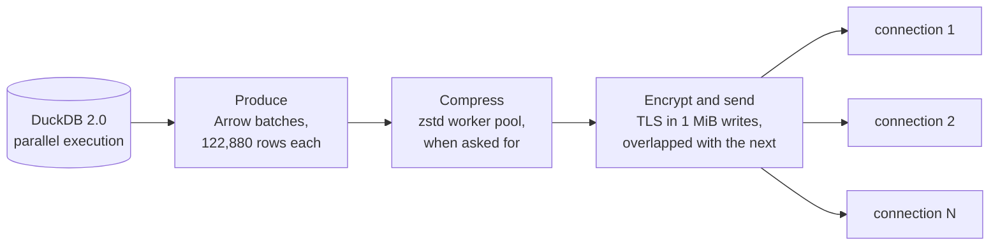

import { Card, CardGrid, LinkCard } from '@astrojs/starlight/components';
import HeroBanner from '../../components/HeroBanner.astro';
import banner from '../../assets/banners/hardcharger-banner.svg';

<HeroBanner src={banner} alt="Hardcharger™ by GizmoData™: the DuckDB 2.0 server that speaks Warp SQL" href="https://gizmodata.com" />

  
  
  
  
  
  
  
  

Fast, secure, remote DuckDB. Every feature included.

**Hardcharger™** puts [DuckDB 2.0](https://duckdb.org) on the network. Clients connect over
[Warp SQL](/concepts/warp-sql/), an open HTTP protocol that moves
[Apache Arrow](https://arrow.apache.org) record batches straight from DuckDB to your
application. It is the successor to GizmoSQL, rebuilt for DuckDB 2.0, and it is free:
no editions and no license keys.

<CardGrid>
  <LinkCard title="🚀 Quickstart" description="A running server and a first query in about a minute." href="/get-started/quickstart/" />
  <LinkCard title="🔌 Your first query" description="Python, Go, Java, JavaScript, the CLI or curl, side by side." href="/get-started/first-query/" />
  <LinkCard title="⚡ Warp SQL in one page" description="Sessions, statements, streaming, partitions and resumable results." href="/concepts/warp-sql/" />
  <LinkCard title="🔁 Coming from GizmoSQL" description="Every GizmoSQL name, mapped to its Hardcharger name." href="/get-started/coming-from-gizmosql/" />
</CardGrid>

## 🏎️ Built for speed

Every result travels through an **asynchronous pipeline**. No stage waits for another
unless a queue is full.

<CardGrid>
  <Card title="Overlapped stages" icon="rocket">
    DuckDB keeps producing while earlier batches are compressed and encrypted. With TLS on,
    one stream runs as fast as plain HTTP.
  </Card>
  <Card title="Partitioned results" icon="random">
    Ask for a large result as several partitions and read them over separate connections at
    once. `ORDER BY` still holds.
  </Card>
  <Card title="Partitioned uploads" icon="download">
    Large loads go up in parts over several connections and into DuckDB on all of its threads, in one
    transaction. A failed load leaves nothing behind.
  </Card>
  <Card title="Never at the cost of correctness" icon="approve-check">
    A result is complete only when every partition has arrived with its end-of-stream marker.
  </Card>
</CardGrid>

Over a real network (two AWS c8gn.8xlarge machines, TLS, median of five runs), against
GizmoSQL 1.42 on the same data:

| Workload | Hardcharger | GizmoSQL 1.42 | |
|---|---:|---:|---:|
| Fetch SF10 lineitem (60M rows, 10.5 GB of Arrow) | **0.97 s** | 15.2 s | **15.7× faster** |
| Fetch SF1 lineitem (6M rows) | **0.148 s** | 1.74 s | **11.7× faster** |
| Fetch 100M narrow rows | **0.45 s** | 5.43 s | **12.0× faster** |
| Fetch SF1 lineitem across regions (46 ms away) | **1.96 s** | 12.26 s | **6.3× faster** |
| Load SF10 lineitem (bulk ingest, 8 upload parts) | **3.00 s** | 9.44 s | **3.1× faster** |
| Load SF1 lineitem across regions (8 upload parts) | **2.91 s** | 13.94 s | **4.8× faster** |

The data is derived from TPC-H (DuckDB's `tpch` extension at scale factor 1 or 10). Derived from
the TPC-H benchmark; not an official TPC-H result and not comparable to published TPC-H results,
as these results do not comply with the TPC-H specification. TPC-H™ is a trademark of the
Transaction Processing Performance Council (TPC). The method, every run and what Hardcharger
doesn't win yet are on the [benchmarks page](/benchmarks/). How the pipeline works is in the
[performance model](/concepts/performance-model/).

## 📦 Everything included

| | |
|---|---|
| 🦆 DuckDB 2.0, DuckLake and DuckDB's extensions | ✅ |
| 🖥️ Built-in web UI: SQL editor, results grid, schema browser, exports (`--web-ui`) | ✅ |
| ⚡ Warp SQL: streamed and resumable results, bind parameters, prepared statements, bulk ingest, zstd | ✅ |
| 🔐 TLS and mTLS, password and token sign-in, SSO via OIDC/JWKS, browser sign-in, authorized e-mail filters | ✅ |
| 👥 Role-based access control: users, roles, grants, ownership, system privileges | ✅ |
| 🛡️ Row policies, column masking, tenants, per-catalog access rules, Open Policy Agent | ✅ |
| 🧾 Tamper-evident audit log | ✅ |
| 🔭 Session and statement instrumentation, catalog logging, query profiles | ✅ |
| 📈 Prometheus `/metrics` and SQL metrics | ✅ |
| 🚦 Statement queue, timeouts, `KILL SESSION`, graceful shutdown | ✅ |
| 💳 License key | Not needed |

## 🔌 Pick your client

<CardGrid>
  <LinkCard title="Python (ADBC)" href="/clients/python/" description="adbc-driver-hardcharger: DB-API with Arrow tables." />
  <LinkCard title="Java (JDBC)" href="/clients/jdbc/" description="One jar for Java 17+, DBeaver and BI tools." />
  <LinkCard title="Go (ADBC)" href="/clients/go/" description="The native Hardcharger ADBC driver, as a Go package." />
  <LinkCard title="The hardcharger CLI" href="/clients/cli/" description="An interactive shell and a scripting tool." />
  <LinkCard title="C, C++, R, Rust" href="/clients/adbc-driver-manager/" description="Any ADBC driver manager, through the driver manifest." />
  <LinkCard title="JavaScript" href="/clients/javascript/" description="Install @gizmodata/hardcharger from npm: Node, browsers, Deno, Bun, Workers." />
  <LinkCard title="Plain HTTP" href="/clients/http/" description="curl, fetch, or any HTTP library." />
  <LinkCard title="🖥️ Web UI" href="/guides/web-ui/" description="Built into the server: a SQL editor, results and schema browser at /ui." />
</CardGrid>

## 💬 Community and support

- Chat with us in the [GizmoData™ Community Slack](https://join.slack.com/t/gizmodatacommunity/shared_invite/zt-42jk7kdti-SJp7qk7d6XYCIKfBG~4HrA).
- Report bugs and ask for features in [GitHub issues](https://github.com/gizmodata/hardcharger/issues).
- For support plans, or to have GizmoData run it for you on [GizmoData Cloud](https://gizmodata.com),
  write to [sales@gizmodata.com](mailto:sales@gizmodata.com).
